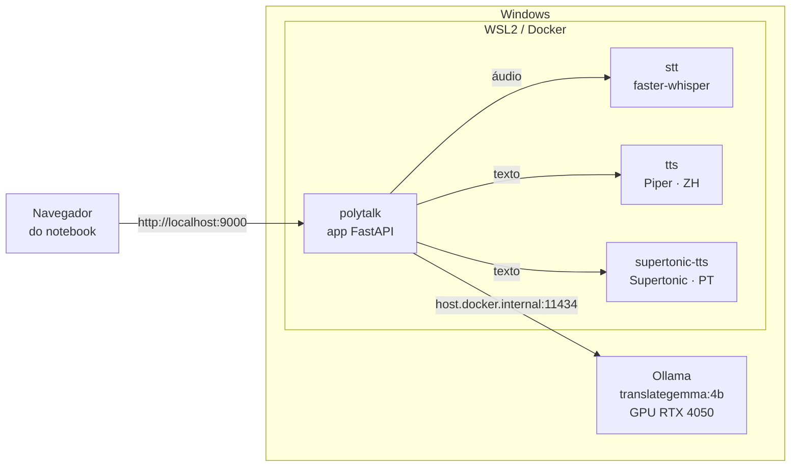

# Etapa 0 – Preparação do ambiente

[← Planejamento](../planejamento.md) · Próxima: [Etapa 1 – Viabilidade →](etapa-1-viabilidade.md)

| | |
|---|---|
| **Objetivo** | Ter o PolyTalk importado neste repositório e rodando no notebook, com tradução local pelo Ollama |
| **Depende de** | — |
| **Libera** | Etapa 1 (viabilidade) e Etapa 4 (rede e HTTPS) |
| **Branch** | `etapa-0-preparacao` (a partir da `main`) |
| **Esforço** | 7P · 1M |
| **Status** | Em andamento: Ollama instalado e `translategemma:4b` testado |

## Subtarefas

| ID | Subtarefa | Tam. | Prioridade | Pronto quando | Status |
|---|---|---|---|---|---|
| 0.1 | Importar o PolyTalk para este repositório preservando o histórico; remote `upstream` | P | Obrigatório | `git log` mostra os commits originais e o README do projeto | Concluída |
| 0.2 | Fluxo de branches: uma branch por etapa, merge na `main` por pull request e tag ao concluir ([planejamento, seção 10.1](../planejamento.md#101-branches)) | P | Importante | Regra resumida no README do fork; esta branch criada | Concluída |
| 0.3 | Configurar `.env` e `config.yaml` locais: tradução no Ollama com `translategemma:4b`, sem chaves no repositório | P | Obrigatório | `.env` e `config.yaml` no `.gitignore`; arquivos de exemplo atualizados | Concluída |
| 0.4 | Subir em modo mock e abrir a interface no navegador do notebook | P | Importante | Fluxo da interface funciona sem modelos | Concluída (falta conferência visual no navegador) |
| 0.5 | Construir as imagens Docker do STT e das vozes (Piper `zh_CN-huayan-medium`, Supertonic para PT) | M | Obrigatório | `docker compose up` sobe os 4 serviços sem erro | Pendente |
| 0.6 | Testar o modo `conversation` real em um único dispositivo, falando PT e ZH | P | Obrigatório | Tradução e voz funcionam nas duas direções | Pendente |
| 0.7 | Manter o modelo carregado na GPU entre falas (tempo de permanência do Ollama) | P | Importante | Sem a recarga de ~7 s depois de uma pausa longa | Pendente |
| 0.8 | Rodar os testes automatizados originais e registrar o resultado como linha de base | P | Obrigatório | Resultado anotado nas notas | Concluída |

## Como o ambiente fica montado

O Docker Compose do PolyTalk sobe 4 serviços (`stt`, `tts`, `supertonic-tts`,
`polytalk`) e **não** inclui serviço de tradução. A tradução é sempre um serviço
externo, indicado em `TRANSLATION_BASE_URL`. Por isso o Ollama fica no Windows.

## Observações

- **Importação do histórico (0.1):** os commits do autor original ficam preservados
  e os nossos aparecem por cima. Isso deixa claro no relatório o que já existia e o
  que foi acrescentado. O README atual deste repositório será substituído pelo do
  fork, com uma seção sobre a extensão.
- **Segredos (0.3):** nenhuma chave de API é necessária, porque a tradução é local.
  Mesmo assim, `.env` e `config.yaml` ficam fora do controle de versão; só os
  arquivos `.example` são versionados.
- **Endereço do Ollama:** de dentro do Docker, `host.docker.internal`; de fora,
  `127.0.0.1`. Nunca `localhost` (custo de ~2 s por chamada no Windows, ver notas).
- **Primeiro carregamento:** o `translategemma:4b` levou 70 s para carregar a frio
  e 7 s com o arquivo já em cache. Por isso a 0.7.
- **RAM:** no momento da análise havia só 1,7 GB livres. Fechar programas ao subir a
  pilha completa; se faltar memória, limitar o WSL.

## Riscos desta etapa

| Risco | Mitigação |
|---|---|
| Memória RAM insuficiente com Docker + Ollama + navegador | Fechar programas; limitar a memória do WSL; Ollama fora do Docker |
| Imagens Docker falham ao construir no Windows/WSL | Construir uma por vez e registrar o erro nas notas; testar primeiro o modo mock (0.4) |

## Saída da etapa

- Repositório com o histórico do PolyTalk e o remote `upstream`.
- Pilha completa rodando no notebook.
- Resultado dos testes originais registrado como linha de base.
