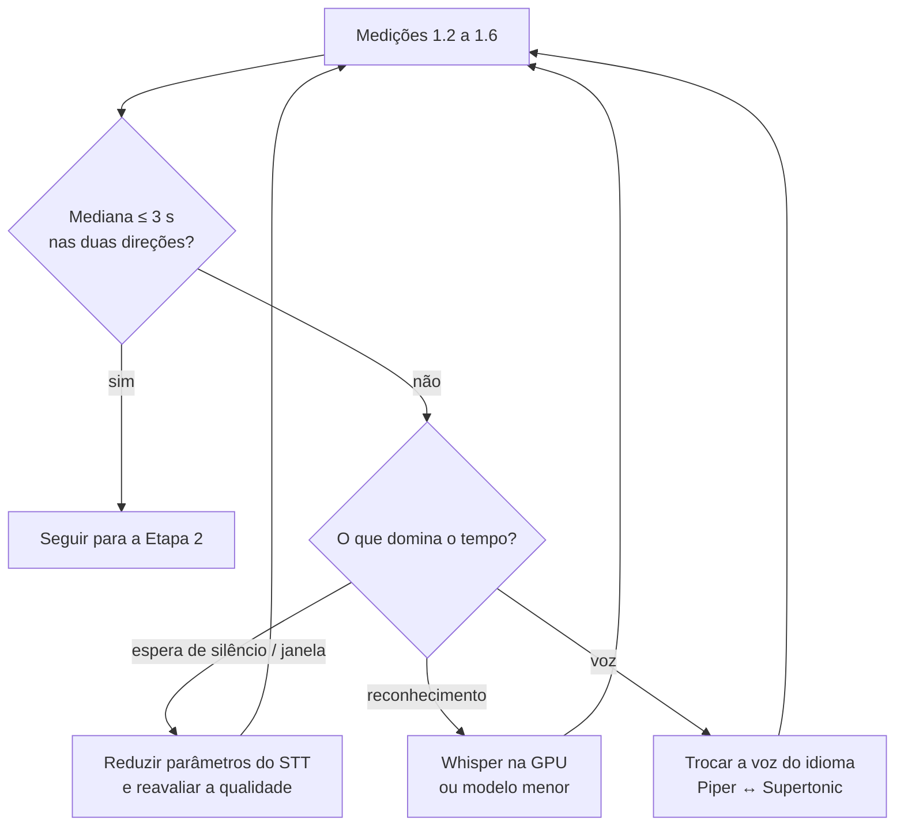

# Etapa 1 – Linha de base e viabilidade

[← Etapa 0 – Preparação](etapa-0-preparacao.md) · [Planejamento](../planejamento.md) · Próxima: [Etapa 2 – Salas no servidor →](etapa-2-salas-servidor.md)

| | |
|---|---|
| **Objetivo** | Saber, **antes de construir as salas**, se a meta de 3 s é alcançável neste notebook e qual configuração usar |
| **Depende de** | Etapa 0 |
| **Libera** | Etapa 2 (só depois do portão) |
| **Branch** | `etapa-1-viabilidade` (a partir da `main`, após o merge da Etapa 0) |
| **Esforço** | 3P · 3M |
| **Status** | Concluída em 2026-11-21 (aguardando PR para a `main`). Portão aprovado: PT→ZH 1,85 s, ZH→PT 2,45 s (mediana) |

## Subtarefas

| ID | Subtarefa | Tam. | Prioridade | Pronto quando | Status |
|---|---|---|---|---|---|
| 1.1 | Montar um conjunto fixo de frases de teste (gravadas em PT e ZH) para todas as medições | P | Obrigatório | Conjunto salvo no repositório, ~10 frases por idioma | Concluída: [bench/](../../bench/README.md), 10 + 10 frases, áudio sintético |
| 1.2 | Medir a latência da configuração padrão no modo `conversation` (fim da fala → início do áudio) | M | Obrigatório | Mediana e p95 por direção registradas | Concluída: PT→ZH 3,46 s / 3,84 s; ZH→PT 4,38 s / 5,06 s (mediana / p95) |
| 1.3 | Avaliar a precisão do STT em chinês e português: Whisper `small` em CPU contra `medium` em GPU (se couber na VRAM com o tradutor) | M | Obrigatório | Tabela de erros e tempo por modelo; escolha registrada | Concluída: `small` fp16 na GPU (0,43 s; mesma precisão do padrão no app). O `medium` foi descartado: disputa VRAM com o tradutor. Detecção automática mantida |
| 1.4 | Ajustar o tempo de silêncio e o tamanho das janelas do STT para conversa; medir antes e depois | M | Obrigatório | Nova configuração com latência e qualidade registradas | Concluída: espera de 0,8 s → PT→ZH 1,67 s, ZH→PT 2,75 s (mediana). Corrigido bug do STT (pausas internas somavam) |
| 1.5 | Medir duas falas simultâneas (dois fluxos de STT ao mesmo tempo) | P | Importante | Latência sob concorrência registrada | Concluída: PT→ZH 2,14 s, ZH→PT 3,32 s (mediana). O gargalo é a voz em CPU, não o STT |
| 1.6 | Medir o tempo de síntese de voz em PT e ZH | P | Importante | Tempo por frase registrado | Concluída: Piper ZH 0,15 s; Supertonic PT 1,48 s → 0,83 s com 4 passos (falta ouvir) |
| **Portão** | **A mediana estimada fica abaixo de 3 s?** Se não, rever os modelos ou os parâmetros antes de seguir | — | Obrigatório | Decisão anotada nas notas | **Aprovado**: 1,85 s e 2,45 s (p95 2,96 e 2,94 s). Ressalvas nas notas |

## Orçamento de latência (3 s)

De onde vem o tempo entre a pessoa terminar de falar e o outro começar a ouvir. Os
valores marcados como "estimado" são o que esta etapa precisa medir.

```text
fim da fala                                                 início do áudio no fone
    │                                                                   │
    ├── espera de silêncio ──┼── STT ──┼─ tradução ─┼── voz ──┼─ envio ─┤
    │   1,2 s (padrão)       │ 0,5–1,5 s│  0,3 s     │   ?     │ ~0,1 s  │
    │   meta: 0,6–0,8 s      │ estimado │  MEDIDO    │ a medir │estimado │
```

| Parte | Hoje | Fonte | Subtarefa |
|---|---|---|---|
| Espera de silêncio para fechar a frase | 1,2 s → **0,8 s** (`STT_PAUSE_FLUSH_SECONDS`) | Escolhida na 1.4 | 1.4 |
| Janela de áudio processada pelo STT | Não se aplica ao modo conversation (só fecha por pausa) | Verificado no código na 1.2 | 1.4 |
| Reconhecimento | `small` CPU: 1,55–1,8 s; `small` GPU: 0,43 s | **Medido** na 1.3 | 1.2, 1.3 |
| Tradução (`translategemma:4b`, GPU) | 0,28–0,35 s isolada; 0,52 s dentro do app | **Medido** em 20/11 e na 1.2 | — |
| Síntese de voz (Piper / Supertonic) | Piper ZH 0,15 s; Supertonic PT 0,83 s (4 passos) | **Medido** na 1.6 | 1.6 |
| Download do arquivo de áudio | 0,01–0,03 s (mesmo computador) | **Medido** na 1.2 | 1.2 |

Só a espera de silêncio padrão já consome 40% do orçamento. Por isso a 1.4 é
obrigatória.

## Portão de decisão



## Observações

- **Conjunto de frases (1.1):** as mesmas frases servem para medir latência agora e
  para avaliar a qualidade na Etapa 6 (6.7). Gravar, e não falar ao vivo, deixa as
  medições comparáveis entre configurações.
- **VRAM (1.3):** o tradutor ocupa 2,9 GB dos 6 GB. O Whisper `medium` na GPU
  provavelmente cabe junto, mas é preciso confirmar com os dois carregados.
- **Idioma do STT (1.3):** com Whisper, detectar o idioma em frases curtas é pouco
  confiável. Numa sala, cada participante declara o idioma em que fala, então dá
  para fixar o idioma e evitar o erro. A desvantagem é perder o sinal usado no
  filtro de conversa cruzada (2.7). A decisão sai desta medição.
- **Concorrência (1.5):** o STT do PolyTalk tem 2 workers por padrão, e o Ollama
  processa pedidos em fila. Duas falas simultâneas devem funcionar, mas a segunda
  pode esperar a primeira.

## Riscos desta etapa

| Risco | Mitigação |
|---|---|
| Latência acima de 3 s por causa do STT em CPU e da espera por silêncio | Portão de decisão; ajustar parâmetros; Whisper na GPU |
| Whisper `small` erra muito em chinês | Comparar com `medium`; fixar o idioma por participante |
| Reduzir a espera de silêncio corta frases no meio | Medir qualidade junto com latência na 1.4 |
| Ruído de fundo acima de −50 dBFS impede o STT de detectar o fim da frase (medido na 1.4) | Medir o fundo dos celulares na Etapa 3; subir `STT_SILENCE_RMS_THRESHOLD` ou usar VAD |

## Saída da etapa

- Configuração do STT escolhida e justificada.
- Tabela de latência por parte e por direção.
- Decisão do portão registrada nas notas.
