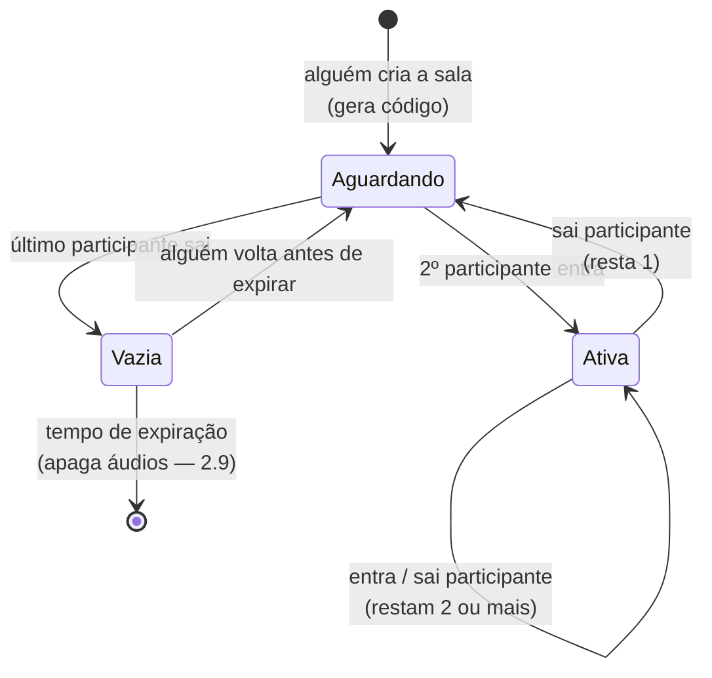
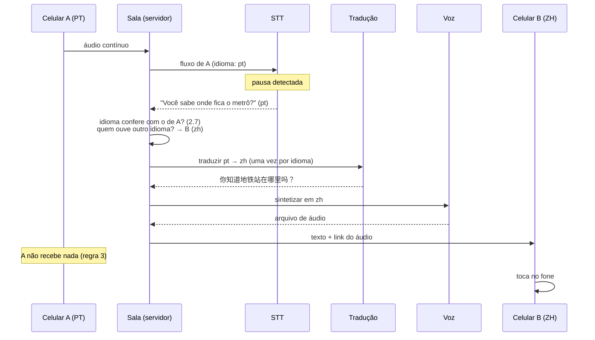

# Etapa 2 – Salas e participantes no servidor

[← Etapa 1 – Viabilidade](etapa-1-viabilidade.md) · [Planejamento](../planejamento.md) · Próxima: [Etapa 3 – Interface →](etapa-3-interface-celular.md)

| | |
|---|---|
| **Objetivo** | Criar salas no servidor, com um fluxo de STT por participante e a tradução entregue só ao ouvinte certo |
| **Depende de** | Etapa 1 (portão aprovado) |
| **Libera** | Etapa 3 (interface) e Etapa 5 (latência) |
| **Branch** | `etapa-2-salas-servidor` (a partir da `main`, após o merge da Etapa 1; em paralelo com `etapa-4-rede-https`) |
| **Esforço** | 6P · 4M · 1G (é o núcleo da contribuição) |
| **Status** | Concluída (PR para a `main`) |

## Subtarefas

| ID | Subtarefa | Tam. | Prioridade | Pronto quando | Status |
|---|---|---|---|---|---|
| 2.1 | Definir o modelo de dados: sala (código, criação, participantes) e participante (nome, idioma de fala, idioma de escuta, conexão) | P | Obrigatório | Documento curto de projeto nas notas | Concluída: projeto nas notas (módulo `app/rooms/`, protocolo) |
| 2.2 | Ciclo de vida da sala: criar, entrar por código, sair, sala vazia expira | M | Obrigatório | Testes cobrem os quatro casos | Concluída: `TestRoomLifecycle` |
| 2.3 | Ponto de conexão da sala: cada participante abre uma conexão que envia o áudio e recebe as traduções | M | Obrigatório | Dois clientes de teste conectados na mesma sala | Concluída: `POST /api/rooms`, `WS /api/ws/rooms/{code}`; teste com dois clientes |
| 2.4 | Um fluxo de STT por participante, usando o idioma de fala declarado | M | Obrigatório | A fala de cada cliente é transcrita no idioma certo | Concluída: detecção automática; `ROOM_STT_LANGUAGE_MODE=fixed` como plano B |
| 2.5 | Roteamento: traduzir e sintetizar uma vez por idioma de escuta e entregar só aos ouvintes dele, nunca a quem falou | G | Obrigatório | Teste com cliente PT e cliente ZH: cada um recebe apenas a tradução do outro | Concluída: `TestRouting`; sala real 40/40 sem vazamentos |
| 2.6 | Ordem das mensagens: falas do mesmo participante chegam na ordem em que foram ditas | P | Obrigatório | Teste com falas em sequência rápida | Concluída: uma fila e um worker por participante |
| 2.7 | Filtro de conversa cruzada: descartar trechos cujo idioma detectado não é o idioma de fala daquele participante | M | Importante | Fala em ZH no microfone do participante PT é ignorada | Concluída: modo `room`; 20/20 falas cruzadas descartadas na sala real |
| 2.8 | Avisar a sala quando alguém entra ou sai e mostrar o estado de cada participante | P | Desejável | Os clientes recebem a lista atualizada | Concluída: `participant_joined`/`left` + `room_state` |
| 2.9 | Limpar os arquivos de áudio gerados ao fim da sala | P | Importante | A pasta de mídia não cresce sem limite | Concluída: ao expirar a sala e após 10 min; conferido no container |
| 2.10 | Registrar marcas de tempo por fala (fim da fala, STT, tradução, voz, envio) | P | Obrigatório | O log permite reconstruir a latência de cada fala | Concluída: `logs/room-timing.jsonl`; fim da fala estimado no servidor |
| 2.11 | Garantir que os modos `live` e `conversation` originais continuam funcionando | P | Obrigatório | Testes originais passam | Concluída: 489 passam, 4 falhas da linha de base (Windows) |

Os testes automatizados desta etapa (6.1, 6.2 e 6.3) são escritos **junto** com
as subtarefas, não no final.

## Ciclo de vida de uma sala

## Uma fala, do microfone ao fone

Exemplo com a pessoa A (fala PT) e a pessoa B (ouve ZH):

## Observações

- **Reaproveitamento:** a lógica do modo `conversation` (`_conversation_direction`
  e `_process_conversation_streaming` em `app/services/pipeline_service.py`) já faz
  quase tudo para uma fala. A diferença é **para quem** o resultado vai. A ideia é
  criar as salas como um **módulo novo**, alterando o mínimo possível dos arquivos
  originais (risco de compatibilidade, 2.11).
- **Um STT por participante (2.4):** hoje cada conexão já abre o próprio fluxo com
  o serviço STT. A sala mantém esse comportamento: um fluxo por celular conectado.
- **Tradução por idioma, não por pessoa (2.5):** com N ouvintes de chinês, a frase é
  traduzida e sintetizada uma vez só. Isso prepara o caso de N participantes sem
  custo extra.
- **Conversa cruzada (2.7):** com as pessoas frente a frente, o microfone de A capta
  a voz de B. Se o STT de A devolver um trecho detectado como chinês, ele é
  descartado, porque A declarou que fala português. Depende da decisão da 1.3
  (idioma fixo ou detecção).
- **Marcas de tempo (2.10):** são a base da Etapa 5. Vale definir aqui os nomes dos
  eventos para não precisar refazer depois.
- **Arquivos de áudio (2.9):** a voz é salva em `/media/output` e o navegador
  recebe o link. Sem limpeza, a pasta cresce sem limite e guarda conversas no
  disco.

## Riscos desta etapa

| Risco | Mitigação |
|---|---|
| Conversa cruzada: o microfone de um capta a voz do outro | Filtro por idioma (2.7); cancelamento de ruído do navegador |
| Mudanças grandes demais no código original | Salas como módulo novo; 2.11 e testes originais |
| Duas falas ao mesmo tempo atrasam uma à outra | Medido na 1.5; ordem garantida por participante (2.6) |

## Resultado

- Módulo `app/rooms/`; do código original só mudaram `app/main.py` (3 linhas) e
  os padrões `APP_WORKERS=1` e `ROOM_*` no `docker-compose.yml`.
- 30 testes novos (`tests/test_rooms.py`), sem modelos.
- Sala real com dois participantes simulados (`bench/testar_sala.py`): 40/40 frases
  entregues só a quem devia, 0 vazamentos e 20/20 falas cruzadas descartadas.
  Latência igual à do modo `conversation` (PT→ZH 1,81 s, ZH→PT 2,59 s sem
  conversa cruzada; 2,02 / 2,76 s com ela).
- Detalhes, protocolo e medições nas
  [notas](../notas-implementacao.md#2026-11-21--etapa-2-branch-etapa-2-salas-servidor).

## Saída da etapa

- Salas funcionando com clientes de teste em modo mock.
- Testes automatizados de salas, roteamento e filtro passando.
- Log com marcas de tempo por fala.
