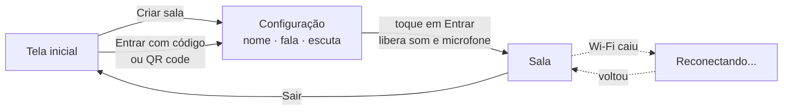

# Etapa 3 – Interface web para celular

[← Etapa 2 – Salas no servidor](etapa-2-salas-servidor.md) · [Planejamento](../planejamento.md) · Próxima: [Etapa 4 – Rede e HTTPS →](etapa-4-rede-https.md)

| | |
|---|---|
| **Objetivo** | Telas para criar ou entrar numa sala, escolher os idiomas e ouvir as traduções no fone |
| **Depende de** | Etapa 2 (salas) e Etapa 4 (HTTPS, para testar no celular) |
| **Libera** | Etapa 6 (validação com dois celulares) |
| **Branch** | `etapa-3-interface-celular` (a partir da `main`, após o merge das Etapas 2 e 4) |
| **Esforço** | 7P · 3M |
| **Status** | Pendente |

## Subtarefas

| ID | Subtarefa | Tam. | Prioridade | Pronto quando | Status |
|---|---|---|---|---|---|
| 3.1 | Tela inicial: criar sala ou entrar por código | M | Obrigatório | Funciona em tela de celular | Pendente |
| 3.2 | Configuração do participante: nome, idioma de fala e de escuta | P | Obrigatório | Escolhas enviadas ao entrar | Pendente |
| 3.3 | Tela da sala: participantes, indicador de microfone ativo, legenda das últimas traduções, botão de silenciar | M | Obrigatório | Uso com uma mão no celular | Pendente |
| 3.4 | Liberar o áudio com o toque em "Entrar" (os celulares bloqueiam som tocado sem gesto do usuário) | P | Obrigatório | A primeira tradução toca sem novo toque | Pendente |
| 3.5 | Fila de reprodução: traduções tocam em sequência, sem sobreposição | P | Obrigatório | Duas traduções seguidas não se sobrepõem | Pendente |
| 3.6 | Manter a tela ligada durante a sala (o microfone para quando o celular bloqueia) | P | Importante | Conversa de 5 min sem a tela apagar | Pendente |
| 3.7 | Reconexão automática se o Wi-Fi oscilar | M | Desejável | Derrubar e restaurar a rede não exige entrar de novo | Pendente |
| 3.8 | Textos da interface em português e chinês (o PolyTalk não tem a tradução da interface para chinês) | P | Desejável | Interface completa em ZH | Pendente |
| 3.9 | Mostrar o código da sala como QR code para o segundo celular entrar | P | Desejável | Entrar apontando a câmera | Pendente |
| 3.10 | Aviso de licença AGPL com link para o código-fonte do fork | P | Importante | Link visível na interface | Pendente |

## Fluxo de telas



## Esboço da tela da sala

```text
┌──────────────────────────────┐
│  Sala  K7Q-29        [ Sair ]│
│                              │
│  ● Ana (PT)       falando... │
│  ● 李伟 (ZH)       ouvindo    │
│                              │
│  ─── últimas traduções ───   │
│  李伟: Você é de São Paulo?   │
│  李伟: A comida aqui é ótima. │
│                              │
│                              │
│      [ 🎤  Microfone ativo ] │
│      [    Silenciar        ] │
│                              │
│  Código-fonte (AGPL-3.0)     │
└──────────────────────────────┘
```

A legenda mostra a tradução **no idioma de quem está segurando o celular**. Ela
ajuda quando a voz não for entendida e serve de apoio na validação.

## Observações

- **Reaproveitamento:** o PolyTalk já tem a captura de áudio pronta
  (`app/static/js/audio-recorder.js`), com cancelamento de eco e supressão de ruído
  ligados. A interface da sala reaproveita esse módulo. A tela original continua
  existindo para os modos `live` e `conversation`.
- **Som bloqueado (3.4):** navegadores de celular, principalmente o Safari no iOS, só
  tocam áudio depois de um toque do usuário. O toque em "Entrar" precisa "liberar"
  a reprodução para as traduções seguintes tocarem sozinhas. É requisito do
  critério "sem acionar botões a cada fala".
- **Tela apagada (3.6):** com a tela bloqueada, o navegador pausa o microfone. Manter
  a tela ligada enquanto a sala está aberta.
- **Fila (3.5):** hoje o PolyTalk toca cada áudio assim que chega. Numa conversa,
  duas traduções em sequência se sobreporiam.
- **Chinês (3.8):** a interface do PolyTalk está em 14 idiomas, mas não em chinês.
  Basta acrescentar o arquivo de textos ao sistema que já existe.

## Riscos desta etapa

| Risco | Mitigação |
|---|---|
| Celular bloqueia som sem toque ou desliga o microfone com a tela apagada | 3.4 e 3.6; testar em Android e iOS |
| Fone Bluetooth com microfone ativo cai para qualidade de chamada | Testar cedo; se necessário, microfone do celular e só o áudio no fone |
| Interface pequena demais para uso com uma mão | Testar cada tela num celular real, não só no navegador do notebook |

## Saída da etapa

- Interface funcionando em Chrome Android e Safari iOS.
- Fluxo completo: criar sala → segundo celular entra → conversa.
