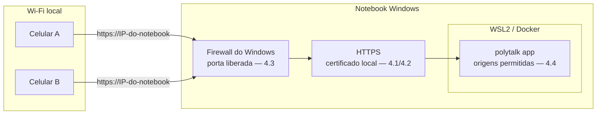

# Etapa 4 – Rede local e HTTPS

[← Etapa 3 – Interface](etapa-3-interface-celular.md) · [Planejamento](../planejamento.md) · Próxima: [Etapa 5 – Latência →](etapa-5-latencia.md)

| | |
|---|---|
| **Objetivo** | Celulares na mesma Wi-Fi acessando o notebook por HTTPS, com o microfone liberado |
| **Depende de** | Etapa 0 |
| **Libera** | Etapa 3 (testes da interface no celular) |
| **Pode correr em paralelo com** | Etapa 2 — boa candidata para o segundo integrante |
| **Branch** | `etapa-4-rede-https` (a partir da `main`, junto com `etapa-2-salas-servidor`) |
| **Esforço** | 5P · 1M |
| **Status** | Pendente |

## Subtarefas

| ID | Subtarefa | Tam. | Prioridade | Pronto quando | Status |
|---|---|---|---|---|---|
| 4.1 | Escolher como servir HTTPS na rede local (certificado local confiável ou autoassinado, direto no servidor ou por proxy) | P | Obrigatório | Decisão registrada com prós e contras | Pendente |
| 4.2 | Gerar o certificado e configurar o servidor para responder no IP do notebook na Wi-Fi | M | Obrigatório | `https://<ip-do-notebook>` abre no celular | Pendente |
| 4.3 | Liberar a porta no firewall do Windows e expor a porta do Docker/WSL para a rede | P | Obrigatório | Celular alcança o notebook | Pendente |
| 4.4 | Ajustar as origens permitidas do servidor (hoje só aceita `localhost`) | P | Obrigatório | Sem erro de origem no celular | Pendente |
| 4.5 | Microfone liberado em Chrome Android e Safari iOS | P | Obrigatório | Os dois navegadores capturam áudio | Pendente |
| 4.6 | Guia de instalação do certificado nos celulares | P | Importante | Passo a passo no README | Pendente |

## Caminho de um celular até o app

Cada camada pode bloquear a conexão. Quando algo não funcionar, testar de fora
para dentro: o celular alcança o notebook? O certificado é aceito? O app aceita a
origem?

## Por que HTTPS é obrigatório

Os navegadores só liberam o microfone em páginas seguras. `http://localhost` conta
como seguro, mas `http://192.168.x.x` não conta. Sem HTTPS, o celular nem pergunta
se pode usar o microfone.

## Alternativas para a 4.1

| Opção | Como funciona | Prós | Contras |
|---|---|---|---|
| Certificado autoassinado | O próprio notebook gera um certificado | Nada para instalar | O celular mostra alerta de segurança; o Safari no iOS pode recusar o WebSocket seguro |
| Autoridade local confiável | Cria-se uma autoridade local e instala-se o certificado dela em cada celular | Sem alertas, funciona em todos os navegadores | Instalação manual em cada celular (por isso a 4.6) |
| HTTPS direto no servidor | O próprio app atende HTTPS | Menos peças | Mexe na inicialização do app original |
| Proxy na frente do app | Um serviço a mais no Docker cuida do HTTPS | Não toca no app original | Mais um contêiner |

## Observações

- **Origens permitidas (4.4):** o PolyTalk aceita por padrão apenas
  `http://localhost:9000` e `http://127.0.0.1:9000` (`ALLOWED_ORIGINS`). O endereço
  HTTPS do notebook na Wi-Fi precisa entrar nessa lista.
- **IP do notebook:** pode mudar de uma rede para outra. O guia (4.6) deve explicar
  como descobri-lo, e o QR code da Etapa 3 (3.9) evita digitá-lo.
- **Wi-Fi da universidade:** redes públicas costumam isolar os aparelhos entre si.
  Para a demonstração, considerar o roteador do celular ou um roteador próprio.

## Riscos desta etapa

| Risco | Mitigação |
|---|---|
| Certificado local recusado pelo celular | Duas alternativas na 4.1; guia 4.6 |
| Rede Wi-Fi isola os aparelhos entre si | Usar roteador do celular ou roteador próprio na demonstração |
| Porta do Docker/WSL não aparece na rede | Testar 4.3 isoladamente antes de 4.2 |

## Saída da etapa

- `https://<ip-do-notebook>` abrindo nos dois celulares, com o microfone liberado.
- Guia de instalação do certificado no README.
