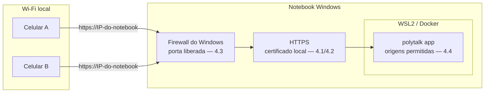

# Etapa 4 – Rede local e HTTPS

[← Etapa 3 – Interface](etapa-3-interface-celular.md) · [Planejamento](../planejamento.md) · Próxima: [Etapa 5 – Latência →](etapa-5-latencia.md)

| | |
|---|---|
| **Objetivo** | Celulares na mesma Wi-Fi acessando o notebook por HTTPS, com o microfone liberado |
| **Depende de** | Etapa 0 |
| **Libera** | Etapa 3 (testes da interface no celular) |
| **Pode correr em paralelo com** | Etapa 2 — boa candidata para o segundo integrante |
| **Branch** | `etapa-4-rede-https` (a partir da `main`, junto com `etapa-2-salas-servidor`) |
| **Esforço** | 5P · 1M |
| **Status** | Implementada; falta conferir o microfone nos dois celulares (4.5) |

## Subtarefas

| ID | Subtarefa | Tam. | Prioridade | Pronto quando | Status |
|---|---|---|---|---|---|
| 4.1 | Escolher como servir HTTPS na rede local (certificado local confiável ou autoassinado, direto no servidor ou por proxy) | P | Obrigatório | Decisão registrada com prós e contras | Concluída: proxy Caddy com autoridade local (ver [Decisão](#decisão-da-41)) |
| 4.2 | Gerar o certificado e configurar o servidor para responder no IP do notebook na Wi-Fi | M | Obrigatório | `https://<ip-do-notebook>` abre no celular | Implementada: `docker-compose.https.yml` + `caddy/`; `https://192.168.1.16:9443` validado pelo IP da Wi-Fi com a raiz baixada; falta abrir no celular |
| 4.3 | Liberar a porta no firewall do Windows e expor a porta do Docker/WSL para a rede | P | Obrigatório | Celular alcança o notebook | Implementada: `tools/rede-local.ps1 -Firewall` (porta 9443 e 9080, só sub-rede local); o Docker Desktop já tem regra no perfil Público; falta conferir de um celular |
| 4.4 | Ajustar as origens permitidas do servidor (hoje só aceita `localhost`) | P | Obrigatório | Sem erro de origem no celular | Concluída: o script põe as origens HTTPS em `ALLOWED_ORIGINS`; o app passou a ver `https` atrás do proxy (`FORWARDED_ALLOW_IPS`) |
| 4.5 | Microfone liberado em Chrome Android e Safari iOS | P | Obrigatório | Os dois navegadores capturam áudio | Pendente: conferência humana (abaixo) |
| 4.6 | Guia de instalação do certificado nos celulares | P | Importante | Passo a passo no README | Concluída: README, seção "usar a sala pelos celulares", e página `http://<IP>:9080` em PT e ZH |

## Caminho de um celular até o app

Cada camada pode bloquear a conexão. Quando algo não funcionar, testar de fora
para dentro: o celular alcança o notebook? O certificado é aceito? O app aceita a
origem?

## Por que HTTPS é obrigatório

Os navegadores só liberam o microfone em páginas seguras. `http://localhost` conta
como seguro, mas `http://192.168.x.x` não conta. Sem HTTPS, o celular nem pergunta
se pode usar o microfone.

## Alternativas para a 4.1

| Opção | Como funciona | Prós | Contras |
|---|---|---|---|
| Certificado autoassinado | O próprio notebook gera um certificado | Nada para instalar | O celular mostra alerta de segurança; o Safari no iOS pode recusar o WebSocket seguro |
| Autoridade local confiável | Cria-se uma autoridade local e instala-se o certificado dela em cada celular | Sem alertas, funciona em todos os navegadores | Instalação manual em cada celular (por isso a 4.6) |
| HTTPS direto no servidor | O próprio app atende HTTPS | Menos peças | Mexe na inicialização do app original |
| Proxy na frente do app | Um serviço a mais no Docker cuida do HTTPS | Não toca no app original | Mais um contêiner |

## Observações

- **Origens permitidas (4.4):** o PolyTalk aceita por padrão apenas
  `http://localhost:9000` e `http://127.0.0.1:9000` (`ALLOWED_ORIGINS`). O endereço
  HTTPS do notebook na Wi-Fi precisa entrar nessa lista.
- **IP do notebook:** pode mudar de uma rede para outra. O guia (4.6) deve explicar
  como descobri-lo, e o QR code da Etapa 3 (3.9) evita digitá-lo.
- **Wi-Fi da universidade:** redes públicas costumam isolar os aparelhos entre si.
  Para a demonstração, considerar o roteador do celular ou um roteador próprio.

## Riscos desta etapa

| Risco | Mitigação |
|---|---|
| Certificado local recusado pelo celular | Duas alternativas na 4.1; guia 4.6 |
| Rede Wi-Fi isola os aparelhos entre si | Usar roteador do celular ou roteador próprio na demonstração |
| Porta do Docker/WSL não aparece na rede | Testar 4.3 isoladamente antes de 4.2 |

## Saída da etapa

- `https://<ip-do-notebook>` abrindo nos dois celulares, com o microfone liberado.
- Guia de instalação do certificado no README.

## Decisão da 4.1

**Proxy Caddy no Docker, com autoridade certificadora local** (opções 2 e 4 da
tabela acima).

| Escolha | Por quê | Custo aceito |
|---|---|---|
| Autoridade local, não autoassinado | Com autoassinado, o celular mostra alerta a cada acesso e o Safari no iOS pode recusar o `wss://` mesmo depois de aceitar a página. Com a raiz instalada, nenhum alerta | Instalar o certificado uma vez em cada celular (guia 4.6) |
| Proxy, não HTTPS no app | O app original não muda (só uma variável de ambiente); o HTTPS liga e desliga pelo `COMPOSE_FILE` | Mais um contêiner (`polytalk-https`, imagem de ~70 MB) |
| Caddy, não nginx | Gera a autoridade e renova os certificados sozinho (`local_certs`), repassa WebSockets sem configuração extra, e o Caddyfile tem 20 linhas | Precisa de `default_sni`: o celular abre por IP e não manda SNI |
| Raiz servida por HTTP na porta 9080 | O celular precisa do certificado *antes* de confiar no HTTPS; a página explica a instalação em PT e ZH | Só a raiz pública é servida, nunca a chave |
| Mkcert descartado | Precisaria instalar no Windows e repetir a geração a cada IP novo | — |

Validade: a raiz vale 10 anos e fica no volume `caddy_data`; o certificado do
site (12 h) é renovado sozinho pelo Caddy. Trocar de rede só exige rodar o script
de novo: o celular não precisa reinstalar nada.

## Como foi feito

| Peça | Arquivo |
|---|---|
| Proxy HTTPS (443 → 9443) e página do certificado (80 → 9080); `FORWARDED_ALLOW_IPS=*` no app para o link do QR sair com `https` | `docker-compose.https.yml` |
| Autoridade local, site no IP da Wi-Fi e em `localhost`, `default_sni`, download da raiz | `caddy/Caddyfile` |
| Página do certificado com o passo a passo Android/iPhone em PT e ZH | `caddy/index.html` |
| Descobre o IP da Wi-Fi (ignora Tailscale, WSL, Docker), preenche o `.env` e, com `-Firewall`, cria a regra | `tools/rede-local.ps1` |
| Teste da sala pelo proxy, validando o certificado como o celular | `bench/testar_sala.py --ca` |
| 8 testes da configuração | `tests/test_https_proxy.py` |

## Verificado no notebook

Tudo pelo IP da Wi-Fi (`192.168.1.16`), não por `localhost`:

| Verificação | Resultado |
|---|---|
| `http://IP:9080` serve a página e a raiz (`application/x-x509-ca-cert`) | OK: "Caddy Local Authority - 2026 ECC Root", válida até 2036 |
| `https://IP:9443` sem SNI (como o celular) valida com a raiz | OK: `Verify return code: 0`, SAN `IP Address:192.168.1.16` |
| Mesmo endereço sem a raiz | Recusado (como deve ser) |
| `https://localhost:9443/sala` | 200 |
| Link do QR sem `ROOM_PUBLIC_BASE_URL`, pelo proxy | `https://192.168.1.16:9443/sala?code=...` (antes sairia `http://`) |
| Raiz depois de reiniciar o proxy | A mesma |
| Sala real pelo proxy (`wss://`, 10 frases por direção, conversa cruzada) | 20/20 entregues, 0 vazamentos, 10/10 cruzadas descartadas por direção |
| Latência pelo proxy (mediana até o áudio) | PT→ZH 2,05 s, ZH→PT 2,73 s; direto na 9000 (Etapa 2): 2,03 s e 2,76 s. O proxy não acrescenta tempo mensurável |
| Script rodado duas vezes e depois com outro IP | `.env` igual na segunda vez; com o IP novo, as origens antigas saem |

Resultado: [bench/resultados/4-sala-https.json](../../bench/resultados/4-sala-https.json).

## Conferência humana pendente

O agente não tem celular nem acesso de outro aparelho à rede. Falta:

| Conferir | Aparelho | Subtarefa |
|---|---|---|
| `http://<IP>:9080` abre (rede não isola, firewall libera) | Qualquer celular | 4.3 |
| Certificado instalado sem erro; `https://<IP>:9443/sala` sem aviso | Android e iPhone | 4.2, 4.6 |
| O navegador pede o microfone e o nível se mexe ao falar | Chrome Android e Safari iOS | 4.5 |
| Se a Wi-Fi da universidade isolar os aparelhos, repetir no roteador do celular | — | risco da etapa |
| Depois disso, a tabela de conferência da [Etapa 3](etapa-3-interface-celular.md#conferência-humana-pendente) | Os dois | 3.x |
