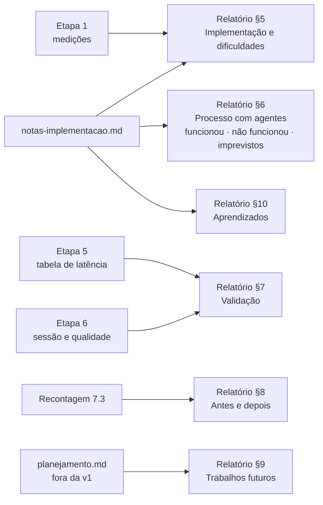

# Etapa 7 – Documentação e entrega

[← Etapa 6 – Testes](etapa-6-testes.md) · [Planejamento](../planejamento.md)

| | |
|---|---|
| **Objetivo** | Deixar o projeto reproduzível por outra pessoa e o relatório completo |
| **Depende de** | Etapa 6 |
| **Libera** | Entrega da Atividade 04 |
| **Branch** | `etapa-7-entrega` (a partir da `main`, após o merge da Etapa 6) |
| **Esforço** | 3P · 2M |
| **Status** | Implementada: README, relatório e recontagem prontos; falta o que depende do grupo (1.1, 10.3, sessão com celulares, vídeo) |

## Subtarefas

| ID | Subtarefa | Tam. | Prioridade | Pronto quando | Status |
|---|---|---|---|---|---|
| 7.1 | README do fork: **o que foi adicionado, como fazer o build e como testar** (itens exigidos pelo enunciado), além de como entrar com os celulares | M | Obrigatório | Outra pessoa consegue reproduzir | Concluída: seções "o que foi adicionado", "build" e "como testar" no README, antes do guia dos celulares |
| 7.2 | Preencher o relatório: familiaridade prévia, processo com agentes (o que funcionou, o que não funcionou, imprevistos), validação, métricas de antes e depois, aprendizados | M | Obrigatório | Nenhuma seção _(a preencher)_ | Concluída do lado do agente; 1.1 e 10.3 marcadas como **Pendente (grupo)**; 10.1 é rascunho para o grupo revisar |
| 7.3 | Recontar arquivos e linhas no fim (mesmo método do apêndice do relatório) | P | Obrigatório | Tabela "antes e depois" completa | Concluída: método do apêndice conferido contra o `2aeadfd` (reproduz 118 / 6.795 / 10.153 / 2.269 / 1.568 / 277) |
| 7.4 | Registrar o uso de agentes de codificação em cada etapa | P | Obrigatório | Seção 6 do relatório preenchida | Concluída: 6.1 com todas as etapas; 6.2 a 6.5 completas |
| 7.5 | Gravar vídeo curto da demonstração com dois celulares | P | Desejável | Vídeo anexado ou com link no relatório | Pendente (grupo): gravar durante a sessão do roteiro |

## De onde vem cada parte do relatório

Se as notas forem mantidas em dia durante as etapas, esta etapa é sobretudo de
organização, e não de reconstruir o que foi feito.

## Lista de conferência da entrega

Itens exigidos pelo enunciado da Atividade 04:

- [x] Link para o fork com o código original e as partes adicionadas: <https://github.com/gabitargino/translator-room>.
- [x] Documentação do que foi adicionado, de como fazer o build e de como testar (README).
- [ ] Relatório focado no processo com agentes e na experiência com um projeto
      existente: o que funcionou, o que não funcionou, imprevistos, familiaridade
      prévia e aprendizados. Pronto, exceto a familiaridade prévia (1.1) e a
      revisão dos aprendizados (10.1) pelo grupo.
- [ ] Apresentação preparada (data a definir pelo professor).

Itens do nosso plano:

- [x] Relatório sem nenhuma seção _(a preencher)_ (restam itens **Pendente (grupo)**).
- [x] Tabela "antes e depois" de funcionalidades e de linhas de código completa.
- [x] Tabela de latência por direção com a definição das marcas de tempo (com clientes simulados; repetir com celulares).
- [ ] Resultado da sessão de 5 minutos e tabela de qualidade: ensaio e nota preliminar feitos; falta a sessão com celulares e a nota humana.
- [x] Seção sobre o uso de agentes de codificação.
- [x] README do fork com instruções de instalação e de uso com os celulares.
- [x] Aviso de licença AGPL e link para o código-fonte na interface (rodapé de `/sala`).
- [x] Nenhuma chave, certificado privado ou `.env` no repositório (conferido com `git ls-files`).
- [x] Nenhum PR, issue ou código enviado ao repositório original (regra da disciplina): o push para `upstream` está desativado e não há PR nem issue do grupo lá.
- [ ] Vídeo da demonstração (desejável).

## Observações

- **Recontagem (7.3):** usar exatamente os comandos do apêndice A do relatório,
  sobre o commit final, para os números serem comparáveis com os do commit
  `2aeadfd`.
- **Uso de agentes (7.4):** o foco da disciplina. Vale incluir exemplos concretos do
  que o agente acertou, do que precisou ser corrigido e de como o planejamento em
  etapas ajudou ou atrapalhou.

## Saída da etapa

- Repositório e relatório prontos para entrega.
