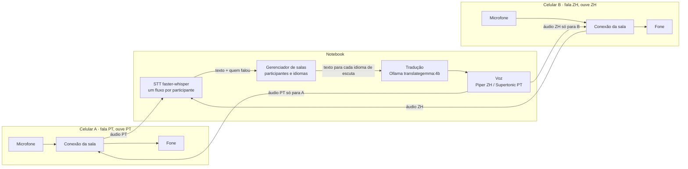
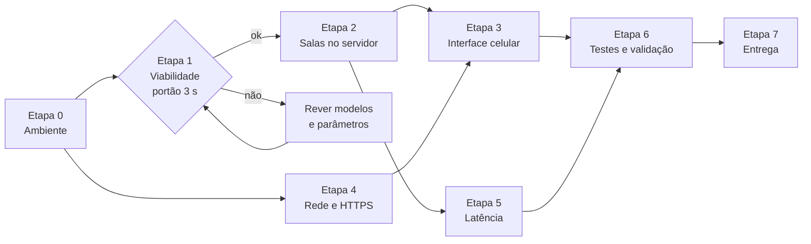
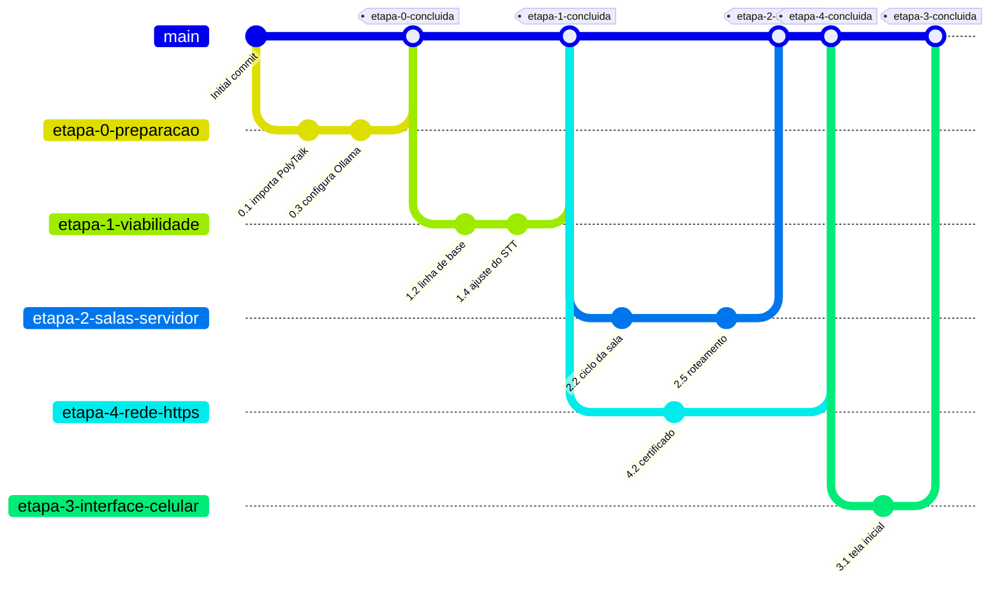

# Planejamento – Salas de Interpretação Simultânea sobre o PolyTalk

**Atividade 04** · Allan Gabriel e Gabriele Targino · criado em 20/11/2026

Documento principal do plano de trabalho. Aqui ficam a visão geral, as decisões, a
arquitetura, as prioridades e os riscos. Cada etapa tem um arquivo próprio em
[`etapas/`](etapas/), com as subtarefas, ilustrações e observações específicas.

### Mapa da documentação

```text
docs/
├── planejamento.md ............ este arquivo: visão geral e índice das etapas
├── etapas/
│   ├── etapa-0-preparacao.md
│   ├── etapa-1-viabilidade.md
│   ├── etapa-2-salas-servidor.md
│   ├── etapa-3-interface-celular.md
│   ├── etapa-4-rede-https.md
│   ├── etapa-5-latencia.md
│   ├── etapa-6-testes.md
│   └── etapa-7-entrega.md
├── notas-implementacao.md ..... diário: medições, decisões, problemas
└── relatorio-atividade04.md ... relatório final da atividade
```

---

## 1. Escopo

### Objetivo da v1

Duas pessoas, cada uma com seu celular e fone de ouvido, entram na mesma sala pelo
navegador. Uma fala português e a outra, chinês. Cada uma ouve no próprio fone apenas
a tradução da fala da outra, sem apertar botões a cada fala. Tudo roda num notebook
na mesma rede Wi-Fi, sem internet.

### Dentro do escopo

- Criar sala e entrar por código.
- Idioma de fala e idioma de escuta por participante.
- Captura contínua do microfone de cada celular.
- Tradução de cada fala para o idioma de cada ouvinte, entregue só a ele.
- Interface web para celular servida pelo próprio notebook, via HTTPS.
- Medição de latência por direção e testes.
- Preservar as funcionalidades originais do PolyTalk (modos `live` e `conversation`).

### Fora do escopo da v1 (registrado como trabalho futuro)

- Mais de 2 participantes ativos (o projeto já nasce preparado, mas não será validado).
- Outros pares de idiomas além de PT ↔ ZH (devem funcionar, mas não serão validados).
- Contas de usuário, histórico persistente de conversas, gravação.
- Publicação na internet e chave de API escolhida pelo usuário.
- Aplicativo nativo.
- Enviar código ao projeto original (regra da disciplina).

## 2. Decisões já tomadas

| Decisão | Escolha | Motivo |
|---|---|---|
| Projeto base | PolyTalk CE, commit `2aeadfd` | Ver relatório, seção 2 |
| Modelo de tradução | `translategemma:4b` via Ollama | Melhor qualidade no teste (0,28–0,35 s por frase, 2,9 GB de VRAM) |
| Onde roda o Ollama | Windows, fora do Docker | Usa a GPU sem configuração e não disputa a RAM do WSL |
| Endereço do Ollama | `host.docker.internal` / `127.0.0.1`, nunca `localhost` | `localhost` adiciona ~2 s por chamada no Windows |
| Servidor | O notebook da equipe (RTX 4050, 6 GB) | Único hardware disponível |
| Forma do fork | Histórico original importado neste repositório (remote `upstream`) | Mantém a autoria original visível e separa nossos commits |

## 3. Como o PolyTalk funciona hoje (o que vamos reaproveitar)

- **Navegador → servidor:** o navegador captura o microfone (já com cancelamento de
  eco e supressão de ruído ligados), converte para áudio de 16 kHz e envia pedaços
  por um WebSocket (`/ws/translate`). Cada aba conectada é uma sessão independente.
- **Servidor → STT:** para cada sessão, o app abre uma conexão própria com o
  serviço de reconhecimento (faster-whisper). No modo `conversation`, o STT recebe
  a lista dos dois idiomas possíveis e devolve o texto quando a pessoa faz uma pausa.
- **Tradução e voz:** o texto vai para o provedor de tradução (Ollama). Depois a voz
  é sintetizada (Piper para chinês, Supertonic para português). O áudio vira um
  arquivo, e o navegador recebe um link para tocá-lo.
- **Modo `conversation`:** decide a direção da tradução pelo idioma detectado em
  cada fala. É a base mais próxima do que queremos. A diferença é que hoje tudo
  acontece em **um único** dispositivo, e o áudio volta para quem falou.

**O que muda conceitualmente:** numa sala, cada celular é uma sessão de quem fala.
Quando uma fala é transcrita, o servidor não devolve a tradução para quem falou. Ele
a envia aos **outros** participantes, cada um no próprio idioma de escuta.

## 4. Arquitetura proposta (visão conceitual)



**Regras de roteamento:**

1. Cada fala é transcrita uma vez, no fluxo de STT de quem falou.
2. Para cada idioma de escuta presente na sala, exceto o de quem falou, a fala é
   traduzida e sintetizada **uma vez**. Com N ouvintes do mesmo idioma, o custo não
   se multiplica.
3. O áudio e o texto traduzidos são enviados apenas aos participantes daquele
   idioma de escuta, nunca de volta a quem falou.
4. Ouvintes com o mesmo idioma de quem falou não recebem nada. A pessoa já entendeu.

O detalhamento (ciclo de vida da sala e sequência de uma fala) está na
[Etapa 2](etapas/etapa-2-salas-servidor.md).

## 5. Etapas

Tamanho das subtarefas: **P** (até meio dia) · **M** (1–2 dias) · **G** (3 dias ou mais).
Os IDs das subtarefas começam pelo número da etapa (ex.: 2.5 é a 5ª subtarefa da Etapa 2).

| # | Etapa | Branch | Objetivo | Subtarefas | Esforço | Status |
|---|---|---|---|---|---|---|
| 0 | [Preparação do ambiente](etapas/etapa-0-preparacao.md) | `etapa-0-preparacao` | Fork importado e PolyTalk rodando no notebook com Ollama | 8 | 7P · 1M | Em andamento |
| 1 | [Linha de base e viabilidade](etapas/etapa-1-viabilidade.md) | `etapa-1-viabilidade` | Provar que a meta de 3 s é alcançável antes de construir as salas | 6 + portão | 3P · 3M | Pendente (tradução já medida) |
| 2 | [Salas e participantes no servidor](etapas/etapa-2-salas-servidor.md) | `etapa-2-salas-servidor` | Salas, um STT por participante e roteamento para o ouvinte certo | 11 | 6P · 4M · 1G | Pendente |
| 3 | [Interface web para celular](etapas/etapa-3-interface-celular.md) | `etapa-3-interface-celular` | Telas para criar/entrar na sala e ouvir as traduções | 10 | 7P · 3M | Pendente |
| 4 | [Rede local e HTTPS](etapas/etapa-4-rede-https.md) | `etapa-4-rede-https` | Celulares acessando o notebook pela Wi-Fi com microfone liberado | 6 | 5P · 1M | Pendente |
| 5 | [Medição de latência](etapas/etapa-5-latencia.md) | `etapa-5-latencia` | Mediana e p95 por direção a partir de sessões reais | 4 | 4P | Pendente |
| 6 | [Testes e validação](etapas/etapa-6-testes.md) | `etapa-6-testes` | Testes automatizados e sessão de 5 min com dois celulares | 7 | 4P · 3M | Pendente |
| 7 | [Documentação e entrega](etapas/etapa-7-entrega.md) | `etapa-7-entrega` | README, relatório completo, métricas e demonstração | 5 | 3P · 2M | Pendente |

Cada etapa é desenvolvida na própria branch. As regras estão na
[seção 10.1](#101-branches).

## 6. Árvore de prioridade

Classificação MoSCoW: **Obrigatório** (sem isso não há entrega), **Importante**
(esperado pelos critérios, mas há contorno), **Desejável** (melhora a experiência)
e **Fora da v1**.

```text
Entrega: conversa PT↔ZH em dois celulares, cada um ouvindo só a sua tradução
│
├── OBRIGATÓRIO (caminho crítico)
│   ├── Ambiente rodando ................................ 0.1, 0.3, 0.5, 0.6
│   ├── Viabilidade da latência (portão) ................ 1.2, 1.3, 1.4
│   ├── Salas no servidor
│   │   ├── Criar / entrar por código / sair ............ 2.1, 2.2, 2.3
│   │   ├── Um STT por participante ..................... 2.4
│   │   └── Roteamento só para o ouvinte certo .......... 2.5, 2.6
│   ├── Interface mínima no celular ..................... 3.1, 3.2, 3.3, 3.4, 3.5
│   ├── Acesso pela Wi-Fi com HTTPS ..................... 4.1, 4.2, 4.3, 4.4, 4.5
│   ├── Medição de latência por direção ................. 2.10, 5.1–5.4
│   ├── Funcionalidades originais preservadas ........... 2.11, 6.4
│   ├── Testes das salas e do roteamento ................ 6.1, 6.2
│   ├── Validação de 5 min com dois celulares ........... 6.5, 6.6, 6.7
│   └── Relatório completo .............................. 7.2, 7.3, 7.4
│
├── IMPORTANTE
│   ├── Filtro de conversa cruzada ...................... 2.7, 6.3
│   ├── Tela sempre ligada .............................. 3.6
│   ├── Medição sob concorrência ........................ 1.5, 1.6
│   ├── Modelo mantido na GPU ........................... 0.7
│   ├── Limpeza de arquivos de áudio .................... 2.9
│   ├── README do fork e guia do certificado ............ 7.1, 4.6
│   └── Aviso de licença AGPL ........................... 3.10
│
├── DESEJÁVEL
│   ├── Reconexão automática ............................ 3.7
│   ├── Interface em chinês ............................. 3.8
│   ├── QR code da sala ................................. 3.9
│   ├── Lista de participantes ao vivo .................. 2.8
│   └── Vídeo da demonstração ........................... 7.5
│
└── FORA DA V1 (trabalhos futuros no relatório)
    ├── Validar 3+ participantes e outros idiomas
    ├── Chave de API escolhida pelo usuário / versão publicada
    ├── Clonagem de voz
    └── Serviço de tradução dentro do Docker Compose
```

## 7. Ordem de execução e dependências



- A **Etapa 4** (HTTPS) não depende das salas e pode correr em paralelo com a 2,
  o que permite dividir o trabalho entre os dois integrantes. Cada uma tem a sua
  branch (ver seção 10.1).
- Os testes automatizados (6.1–6.3) são escritos **junto** com a Etapa 2, não no
  final. A Etapa 6 cuida da validação manual.
- O relatório e as notas são atualizados ao fim de cada etapa (ver seção 10).

## 8. Critérios de aceitação da entrega

Vêm da proposta da Atividade 03:

| Critério | Como será verificado | Subtarefas |
|---|---|---|
| Conversa contínua de 5 min sem acionar botões a cada fala | Sessão cronometrada e gravada com dois celulares | 3.4, 3.6, 6.6 |
| Cada participante ouve apenas a tradução destinada a ele | Observação na sessão + testes automatizados de roteamento | 2.5, 6.2 |
| Latência mediana ≤ 3 s em cada direção (fim da fala → início do áudio) | Tabela gerada pelo log da sessão | 5.1–5.4 |
| Avaliação qualitativa da tradução | Frases de teste nas duas direções, com nota | 1.1, 6.7 |
| Funcionalidades originais preservadas | Suíte original passando | 0.8, 6.4 |

## 9. Riscos e mitigação

Visão geral. Cada arquivo de etapa repete os riscos que lhe dizem respeito.

| Risco | Prob. | Impacto | Mitigação | Etapa |
|---|---|---|---|---|
| Latência acima de 3 s por causa do STT em CPU e da espera por silêncio | Alta | Alto | Portão da Etapa 1; ajustar os parâmetros do STT; Whisper na GPU se couber | 1 |
| Whisper `small` erra muito em chinês | Média | Alto | Comparar com `medium` (1.3); dica de idioma fixo por participante | 1 |
| Conversa cruzada: o microfone de um capta a voz do outro | Alta | Médio | Filtro por idioma (2.7); cancelamento de ruído do navegador; celular perto da boca | 2 |
| Fone Bluetooth com microfone ativo cai para qualidade de chamada | Média | Médio | Testar cedo (4.5); se necessário, usar o microfone do celular e só o áudio no fone | 3, 4 |
| Celular bloqueia som sem toque ou desliga o microfone com a tela apagada | Alta | Alto | 3.4 e 3.6; testar em Android e iOS | 3 |
| Certificado local recusado pelo celular | Média | Alto | 4.1 com duas alternativas; guia 4.6 | 4 |
| Memória RAM insuficiente com Docker + Ollama + navegador | Média | Médio | Fechar programas; limitar a memória do WSL; Ollama fora do Docker | 0 |
| Tradução com erro de sentido ou mistura de idiomas | Média | Médio | Avaliação 6.7; ajustar o prompt; trocar de modelo se necessário | 6 |
| Mudanças grandes demais no código original dificultam manter a compatibilidade | Média | Médio | Salas como módulo novo, alterando o mínimo dos arquivos existentes; 2.11 | 2 |
| Obrigações da AGPL esquecidas | Baixa | Médio | Fork público + aviso na interface (3.10) | 3, 7 |

## 10. Práticas durante a implementação

### 10.1 Branches

**Uma branch por etapa**, com o mesmo nome do arquivo da etapa.

| Regra | Detalhe |
|---|---|
| `main` é estável | Só recebe código pelo merge de uma etapa concluída. Ninguém faz commit direto nela |
| Branch criada no início da etapa | Sempre a partir da `main` atualizada, para já conter as etapas anteriores |
| Merge ao fim da etapa | Quando a "Saída da etapa" do arquivo dela estiver cumprida, por pull request **no nosso repositório** (`origin`), revisado pelo outro integrante |
| Marca de conclusão | Após o merge, uma tag `etapa-N-concluida` na `main`. Isso permite mostrar no relatório o estado exato do projeto ao fim de cada etapa |
| Etapas em paralelo | As Etapas 2 e 4 partem da mesma `main`. A que terminar por último atualiza a sua branch com a `main` antes do merge |
| Documentação junto | Status, notas e relatório são atualizados e commitados na branch da etapa, junto com o código |
| Remote `upstream` | Usado só para ler o PolyTalk original. Nunca recebe push nem pull request (regra da disciplina) |



As Etapas 5, 6 e 7 seguem o mesmo padrão depois da 3.

### 10.2 Registro, agentes e commits

- **Registro contínuo:** ao fim de cada subtarefa, uma entrada curta em
  [notas-implementacao.md](notas-implementacao.md) com o que foi feito, o que foi
  medido e o que deu errado. O relatório é atualizado ao fim de cada etapa.
- **Status:** ao concluir uma subtarefa, atualizar a coluna "Status" no arquivo da
  etapa; ao concluir uma etapa, atualizar a tabela da seção 5 deste arquivo.
- **Agentes de codificação:** anotar nas notas como o agente foi usado em cada
  etapa (análise, plano, código, testes) e o que exigiu correção humana. Isso
  alimenta a seção 6 do relatório. Todo código gerado é revisado por um integrante
  antes do merge.
- **Commits pequenos**, um por subtarefa, com o ID no título (por exemplo, `2.5:
  roteamento por idioma de escuta`). Isso facilita relacionar o histórico ao plano no
  relatório.
- **Regra da disciplina:** nenhum pull request, issue ou código enviado ao
  repositório original do PolyTalk.

## 11. Questões em aberto

| Questão | Quando decidir |
|---|---|
| Whisper `small` em CPU ou `medium` em GPU? | [Etapa 1](etapas/etapa-1-viabilidade.md), subtarefa 1.3 |
| Idioma fixo por participante no STT ou detecção com filtro? | Etapa 1.3 / [Etapa 2](etapas/etapa-2-salas-servidor.md), subtarefa 2.7 |
| HTTPS direto no servidor ou por proxy? Certificado confiável ou autoassinado? | [Etapa 4](etapas/etapa-4-rede-https.md), subtarefa 4.1 |
| Divisão de tarefas entre Allan e Gabriele (sugestão: um nas Etapas 2 e 5, outro nas Etapas 4 e 3) | Antes de iniciar a Etapa 2 |
