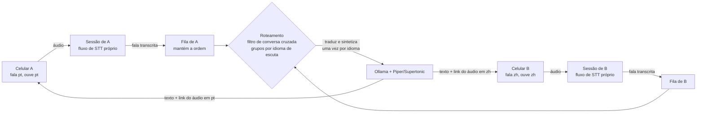

# Atividade 04 – Relatório de Implementação

**Disciplina:** Agentes de Codificação · **Professor:** Andrei Formiga
**Integrantes:** Allan Gabriel e Gabriele Targino
**Projeto da Atividade 03:** Sistema de Interpretação Simultânea Multiusuário em Rede Local

> Documento em construção. As seções marcadas com _(a preencher)_ serão completadas
> ao longo da implementação. Anotações brutas, medições e decisões do dia a dia
> ficam em [notas-implementacao.md](notas-implementacao.md).
>
> **Foco pedido no enunciado:** o processo de desenvolvimento com agentes e a
> experiência de trabalhar num projeto já existente — o que funcionou, o que não
> funcionou, imprevistos, familiaridade prévia do grupo e aprendizados (seções 1.1,
> 6 e 10). As seções técnicas dão o contexto para essa análise.

---

## 1. Objetivo

Permitir que duas (e futuramente N) pessoas que falam idiomas diferentes conversem
frente a frente, cada uma usando o próprio celular e fone de ouvido. Cada
participante entra em uma sala virtual pelo navegador, escolhe seu idioma, fala
normalmente e ouve no próprio fone a tradução da fala do outro. A primeira versão
cobre português ↔ chinês (mandarim), em rede Wi-Fi local, sem depender de internet.

### 1.1 Familiaridade prévia do grupo

_(a preencher pelo grupo: nível de experiência com cada item antes do projeto —
nenhuma, básica, intermediária ou avançada)_

| Tecnologia / técnica usada no projeto | Allan | Gabriele |
|---|---|---|
| Python e FastAPI | | |
| WebSocket e áudio em tempo real no navegador | | |
| JavaScript sem framework (front-end do PolyTalk) | | |
| Docker e Docker Compose | | |
| Modelos de IA locais (Whisper, LLM via Ollama, síntese de voz) | | |
| HTTPS e certificados em rede local | | |
| Testes automatizados com pytest | | |
| Trabalhar num código-base grande escrito por outras pessoas | | |
| Agentes de codificação | | |

## 2. Troca do projeto open source base

### 2.1 Projeto escolhido na Atividade 03

Na proposta (Atividade 03), o projeto base era o
**[open-realtime-translate](https://github.com/JacobLinCool/open-realtime-translate)**
(commit `3bbf77c`, 20/05/2026): um servidor Python que implementa o protocolo da API
Realtime de tradução da OpenAI, executando localmente reconhecimento de fala
(Qwen3-ASR), tradução (TranslateGemma 4B) e síntese de voz (Qwen3-TTS ou Kokoro).

**Funcionalidades existentes:**

- Interpretação fala → fala em tempo real, com modo incremental (trechos fechados
  após ~0,7 s de silêncio) e modo de frase completa.
- Protocolo compatível com a OpenAI Realtime Translation API via WebSocket e WebRTC
  (áudio Opus bidirecional e eventos por DataChannel).
- Clonagem de voz entre idiomas (Qwen3-TTS reproduz o timbre de quem falou).
- Perfis de execução MLX (Apple Silicon), CUDA e CPU; backends `mock` para testes.
- Uma sessão por conexão, com um único idioma de destino; sem salas nem
  múltiplos usuários; sem interface web própria (apenas exemplos de cliente e uma
  demo Gradio).

**Tamanho:**

| Métrica | Valor |
|---|---|
| Arquivos versionados | 53 |
| Tamanho (sem `.git`) | ~0,55 MB |
| Python (total) | 5.591 linhas em 46 arquivos |
| Python sem testes | 4.599 linhas |
| Testes (Python) | 992 linhas |
| Documentação (Markdown) | 376 linhas |

### 2.2 Por que trocar

A análise do código e o levantamento do hardware disponível mostraram que o
projeto original era complexo demais para o escopo e para o equipamento da equipe:

1. **Hardware.** A máquina de desenvolvimento tem uma GPU RTX 4050 com 6 GB de
   VRAM e 15 GB de RAM, em Windows. O perfil de referência do projeto é Apple
   Silicon (MLX), com ~7,1 GB residentes. No perfil CUDA, só o TranslateGemma 4B em
   bf16 ocupa ~8 GB, e a pilha padrão completa ultrapassa 15 GB. O backend de
   tradução em PyTorch não oferece quantização.
2. **Modelos fixos.** As três etapas (ASR, tradução, TTS) são modelos embutidos no
   código. Não há como delegar uma etapa a um serviço externo ou a um modelo menor
   sem modificar backends.
3. **Concorrência.** Toda a inferência passa por uma única thread serializada
   (exigência do MLX). Com dois participantes falando, uma direção da tradução
   espera a outra, o que ameaça a meta de latência de 3 s.
4. **Esforço fora do foco.** A maior parte do trabalho seria adaptar modelos ao
   hardware, e não construir a funcionalidade proposta (salas multiusuário).

### 2.3 Alternativas avaliadas

| Projeto | Arquitetura | Offline | Prós | Contras |
|---|---|---|---|---|
| [open-realtime-translate](https://github.com/JacobLinCool/open-realtime-translate) | Servidor Python, 3 modelos locais fixos | Sim | Latência baixa de fábrica (~2,8 s/trecho em M5 Pro); WebRTC | Não cabe no hardware; fila única de inferência |
| **[PolyTalk CE](https://github.com/PolyTalkIO/polytalk)** (escolhido) | FastAPI + serviços Docker (faster-whisper, Piper/Supertonic) + tradução por API configurável | Sim, com LLM local (Ollama) | Leve (STT/TTS em CPU); tradução plugável; modo conversa bidirecional; mock mode; mantido ativamente | Código maior; latência padrão do STT alta; AGPL-3.0 |
| [live-translate](https://github.com/sglkc/live-translate) | SPA Vue; reconhecimento e voz no navegador (Web Speech API) | Não | Muito simples (~1.800 linhas); quase sem servidor | Depende de internet e do Google; contraria o requisito "rede local" da proposta |

### 2.4 Projeto escolhido: PolyTalk Community Edition

**[PolyTalk CE](https://github.com/PolyTalkIO/polytalk)** (commit `2aeadfd`, versão
0.4.0, 06/07/2026, licença AGPL-3.0, mantido pela BizzAppDev Systems).

**Funcionalidades existentes (antes da contribuição):**

- Captura de áudio no navegador (microfone ou aba compartilhada), enviada por
  WebSocket (`/ws/translate`).
- Reconhecimento de fala por serviço faster-whisper próprio (WebSocket, CPU ou GPU).
- Tradução por qualquer provedor compatível: OpenAI, Ollama, vLLM, LM Studio,
  LiteLLM, Anthropic e Gemini, com roteamento por idioma, contexto entre trechos e
  instrução personalizada do usuário.
- Síntese de voz por Piper e Supertonic, com voz escolhida por idioma (inclui
  chinês e português).
- Modos `live` (tradução contínua em um sentido) e `conversation` (conversa
  bidirecional em **um único dispositivo**, detectando o idioma de cada fala).
- Contexto visual opcional a partir de uma aba compartilhada.
- Interface web em JavaScript puro, traduzida em 14 idiomas (inclui português).
- Modo mock (funciona sem modelos ou chaves), Docker Compose, scripts de benchmark,
  CI e guia de contribuição.
- **Não possui:** salas, múltiplos participantes em dispositivos diferentes,
  nem envio da tradução apenas ao ouvinte de destino.

**Tamanho (antes):**

| Métrica | Valor |
|---|---|
| Arquivos versionados | 118 |
| Tamanho (sem `.git`, inclui amostras de áudio) | ~3,6 MB |
| Python (total) | 16.948 linhas em 46 arquivos |
| Python sem testes | 6.795 linhas |
| Testes (Python) | 10.153 linhas |
| JavaScript | 2.269 linhas em 4 arquivos |
| CSS | 1.568 linhas em 5 arquivos |
| HTML | 277 linhas |
| JSON (traduções da interface) | 2.657 linhas em 14 arquivos |
| Documentação (Markdown) | 1.839 linhas em 14 arquivos |

### 2.5 Vantagens e desvantagens da troca

**Vantagens**

- **Roda no hardware disponível.** STT e TTS rodam em CPU, e a tradução usa um
  modelo pequeno via Ollama (2–3 GB de VRAM). O teste de viabilidade (seção 4)
  mediu 0,15–0,4 s por frase na tradução.
- **Mantém o requisito offline / rede local** da proposta original, ao contrário
  da alternativa baseada no navegador.
- **Tradução plugável.** A mesma instalação pode usar uma LLM local (offline) ou
  uma API externa, apenas por configuração.
- **Ponto de partida mais próximo do objetivo.** O modo `conversation` já resolve a
  detecção de idioma e a direção da tradução; a contribuição passa a ser estender
  isso para vários dispositivos (salas).
- **Arquitetura em serviços.** STT, tradução e TTS são processos separados, então a
  fala de um participante pode ser transcrita enquanto a de outro é traduzida.
- **Projeto mais maduro para manutenção:** testes extensos, mock mode, CI,
  documentação de deploy e de extensão de provedores.

**Desvantagens**

- **Base de código maior** (~6,8 mil linhas de Python de aplicação contra ~4,6 mil),
  com mais componentes (Docker Compose com 4 serviços).
- **Latência padrão inadequada para conversa.** O STT processa janelas de 3 s e
  espera 1,2 s de silêncio antes de liberar o texto; será preciso ajustar e medir.
- **Sem números de latência publicados**: a viabilidade precisa ser medida por nós.
- **Tradução por LLM genérica.** Pode misturar idiomas ou alterar o sentido (ver
  seção 4); a qualidade depende do modelo escolhido.
- **Sem clonagem de voz**, e as vozes Piper/Supertonic são mais simples que as do
  Qwen3-TTS.
- **Licença AGPL-3.0.** Se o serviço modificado for disponibilizado em rede, o
  código-fonte modificado deve ser oferecido aos usuários. O fork público já
  atende a essa exigência.
- **Ajuste da proposta.** A Atividade 03 citava o open-realtime-translate; este
  relatório documenta a mudança.

## 3. Ambiente de desenvolvimento

| Item | Valor |
|---|---|
| Sistema | Windows 11 Home (WSL2 + Docker Desktop) |
| CPU | AMD Ryzen 7 8745HS (8 núcleos) |
| GPU | NVIDIA GeForce RTX 4050 Laptop, 6 GB |
| RAM | 15,3 GB |
| Tradução local | Ollama 0.40.16, fora do Docker, usando a GPU |

## 4. Teste de viabilidade da tradução local

Antes de alterar o projeto, medimos a etapa de tradução isoladamente, chamando o
Ollama da mesma forma que o PolyTalk: endpoint compatível com OpenAI
(`/v1/chat/completions`), prompt de sistema do próprio PolyTalk e temperatura 0.
Foram usadas 6 frases de conversa em cada direção.

| Modelo | VRAM | PT→ZH (mediana) | ZH→PT (mediana) | Observações de qualidade |
|---|---|---|---|---|
| `translategemma:4b` | 2,9 GB | 0,28 s | 0,35 s | ZH→PT natural e correto; 1 erro de sentido em PT→ZH ("falar mais devagar" virou "repetir") |
| `qwen2.5:3b` | 2,2 GB | 0,16 s | 0,25 s | PT→ZH correto; em ZH→PT misturou inglês ("please") e alterou o sentido de uma pergunta |

Conclusão: a tradução local consome menos de 0,5 s do orçamento de 3 s. **O modelo
adotado é o `translategemma:4b`**, que apresentou melhor qualidade, principalmente
em ZH→PT. A amostra é pequena; a avaliação qualitativa completa está prevista na
seção 7.

## 5. Implementação

_(a preencher)_

### 5.1 Arquitetura da solução

As salas são um módulo novo (`app/rooms/`), ao lado do código original. Cada
celular abre uma conexão WebSocket com a sala (`/api/ws/rooms/{código}`) e informa
o nome, o idioma de fala e o idioma de escuta. A conexão envia o áudio do microfone
no mesmo formato do PolyTalk.



- **Uma sessão por participante:** cada conexão tem o próprio fluxo de STT e uma
  fila de falas com um único worker, o que mantém a ordem das falas de cada pessoa.
- **Roteamento:** os ouvintes são agrupados pelo idioma de escuta. Cada grupo
  recebe uma tradução e uma voz. Quem falou não recebe nada, nem quem já ouve o
  idioma de quem falou.
- **Filtro de conversa cruzada:** se o STT de A detecta o idioma de fala de B, o
  trecho é a voz de B captada pelo microfone de A, e é descartado.
- **Ciclo de vida:** a sala vazia expira após 2 min e leva junto os áudios gerados.
  Áudios com mais de 10 min também são apagados com a sala ativa.
- **Marcas de tempo:** uma linha JSON por fala, com o fim da fala estimado no
  servidor e o momento de cada etapa, para a medição da Etapa 5.

Protocolo completo nas [notas da Etapa 2](notas-implementacao.md#21-projeto-das-salas).

### 5.2 Etapas

Plano completo, com subtarefas, árvore de prioridade e riscos, em
[planejamento.md](planejamento.md).

| Etapa | Descrição | Status |
|---|---|---|
| 0 | Preparação do ambiente (fork, Docker, Ollama, modo mock) | Concluída |
| 1 | Linha de base e viabilidade da latência (portão de 3 s) | Concluída: portão aprovado (PT→ZH 1,85 s, ZH→PT 2,45 s) |
| 2 | Salas e participantes no servidor, roteamento por ouvinte | Concluída: sala real com 40/40 frases entregues só a quem devia |
| 3 | Interface web para celular | Implementada: página `/sala`, interface em chinês e QR code; falta conferir nos celulares (precisa do HTTPS da Etapa 4) |
| 4 | Rede local e HTTPS | Pendente |
| 5 | Medição de latência por direção | Pendente |
| 6 | Testes automatizados e validação com dois celulares | Pendente |
| 7 | Documentação e entrega | Pendente |

### 5.3 Principais alterações no código

| Etapa | Alteração | Arquivos |
|---|---|---|
| 0 | Opção `translation.keep_alive` (`TRANSLATION_KEEP_ALIVE`), enviada ao Ollama só quando configurada, para manter o modelo na GPU entre falas. Inclui 4 testes | `app/services/translation_service.py`, `config/config.yaml.example`, `.env.example`, `docker-compose.yml`, `tests/test_translation_detailed.py` |
| 0 | Configuração de exemplo apontando a tradução para o Ollama local (`translategemma:4b`, sem chave) | `.env.example`, `config/config.yaml.example` |
| 0 | `.gitattributes` forçando LF em scripts e Dockerfiles (correção para Windows) | `.gitattributes` |
| 1 | Correção no STT: pausas dentro da frase se somavam como silêncio final, fechando a frase cedo e cortando o fim da fala. Inclui teste | `stt/app/main.py`, `tests/test_app.py` |
| 1 | STT na GPU (`small` fp16), espera de silêncio de 0,8 s e Supertonic com 4 passos; volume para o cache dos modelos | `.env.example`, `docker-compose.gpu.yml` |
| 1 | Conjunto de frases PT/ZH e scripts de medição (latência, STT, voz, concorrência) | `bench/` |
| 2 | Módulo de salas: criação e entrada por código, idioma de fala e de escuta por participante, um STT por participante, roteamento por idioma de escuta, filtro de conversa cruzada, avisos de entrada e saída, limpeza dos áudios e marcas de tempo por fala. Inclui 30 testes | `app/rooms/` (novo), `tests/test_rooms.py` (novo) |
| 2 | Rotas das salas e limpeza periódica ligadas ao app; `APP_WORKERS=1` (as salas ficam na memória do processo); variáveis `ROOM_*`; pasta `logs/` montada no container | `app/main.py`, `docker-compose.yml`, `.env.example` |
| 2 | Teste da sala real com dois participantes simulados e conversa cruzada | `bench/testar_sala.py` |
| 3 | Página da sala para celular: criar ou entrar por código, idiomas de fala e de escuta, lista de participantes, legendas, silenciar, som liberado no toque, fila de reprodução, tela ligada, reconexão automática, convite por QR code e aviso AGPL. Inclui 22 testes | `app/rooms/web.py`, `app/templates/room.html`, `app/static/js/room-app.js`, `app/static/css/room.css`, `tests/test_room_ui.py` (novos) |
| 3 | Interface em chinês (o PolyTalk não tinha), também para a tela original; textos da sala em PT, ZH e EN | `app/locales/zh.json` (novo), `app/locales/en.json`, `app/locales/pt.json`, `app/ui_locales.py` |
| 3 | Servidor: link de entrada nas respostas, QR code em SVG e `rejoin` para substituir o participante antigo numa reconexão; link para a sala na tela original | `app/rooms/router.py`, `app/rooms/models.py`, `app/main.py`, `app/templates/index.html`, `requirements.txt` (`segno`) |

### 5.4 Redução da latência (Etapa 1)

A meta da Atividade 03 é que a mediana entre o fim da fala e o início do áudio
traduzido fique em até 3 s em cada direção. Na configuração original do PolyTalk, a
primeira medição deu 3,46 s (PT→ZH) e 4,38 s (ZH→PT). Depois dos ajustes da Etapa
1, ficou em **1,85 s e 2,45 s**: uma redução de 47% e 44%, sem perda de precisão
medida.

#### Como foi medido

- **Frases:** um conjunto fixo de 20 frases (10 PT, 10 ZH), em `bench/`, usado em
  todas as medições para que as configurações fiquem comparáveis.
- **Áudio:** as frases foram sintetizadas com as vozes da própria pilha e enviadas
  pelo WebSocket como o navegador faz: blocos de 128 ms, em tempo real, com
  silêncio entre as falas. As frases alternam PT e ZH, como numa conversa.
- **Relógio:** parte do último bloco com fala. Cada mensagem do servidor marca uma
  parte do caminho: transcrição (espera de silêncio + reconhecimento), tradução,
  voz e download do arquivo de áudio.
- **Amostra:** 2 rodadas, ou seja, 20 medidas por direção, nas medições principais.
  Os resultados brutos estão em `bench/resultados/`.
- **Ambiente:** tudo rodou no próprio notebook, sem Wi-Fi. A rede até os celulares
  entra nas Etapas 4 e 5.

#### Onde estava o tempo na configuração original

| Parte (mediana, s) | PT→ZH | ZH→PT |
|---|---|---|
| Espera de silêncio (1,2 s) + reconhecimento (Whisper `small` na CPU) | 2,79 | 2,74 |
| Tradução (`translategemma:4b` na GPU) | 0,52 | 0,52 |
| Voz | 0,12 (Piper, ZH) | 1,06 (Supertonic, PT) |
| Download do áudio | 0,02 | 0,01 |
| **Total até o áudio** | **3,46** | **4,38** |

Quase 80% do tempo estava antes da tradução: 1,2 s de espera fixa e ~1,5 s de
reconhecimento na CPU. A tradução, que se temia ser o gargalo, levava 0,5 s. A
direção ZH→PT é sempre mais lenta porque a voz em PT (Supertonic) é ~10× mais lenta
que a voz em ZH (Piper).

#### Mudanças e efeito de cada uma

| Passo | Mudança | PT→ZH | ZH→PT | Medição |
|---|---|---|---|---|
| 0 | Configuração original | 3,46 | 4,38 | `1.2-padrao`, 2 rodadas |
| — | Whisper `medium` na GPU (**descartado**) | 3,44 | 4,67 | `1.3-medium-gpu`, 2 rodadas |
| 1 | Whisper `small` na GPU (fp16) | 2,20 | 3,49 | `1.3-small-gpu`, 1 rodada |
| 2 | Correção do contador de silêncio do STT (não visa latência) | 2,12 | 3,08 | `1.4-pausa-1.2`, 1 rodada |
| 3 | Espera de silêncio de 1,2 s para 0,8 s | 1,67 | 2,75 | `1.4-final`, 2 rodadas |
| 4 | Voz em PT com 4 passos em vez de 8 | **1,85** | **2,45** | `1.6-final`, 2 rodadas |

1. **Reconhecimento na GPU (−1,0 a −1,3 s).** O Whisper `small` passou de
   1,6–1,8 s por frase na CPU para 0,43 s na GPU, com os mesmos acertos. A
   tradução também ficou mais rápida (0,52 → 0,24 s), sem mudança no tradutor. A
   GPU, que antes ficava parada entre as falas e reduzia o clock, agora está
   "acordada" quando a tradução chega.
2. **Correção no STT.** Pausas dentro da frase eram somadas como silêncio final, o
   que fazia o STT fechar a frase cedo e cortar o fim da fala (seção 6.4). A
   correção não mira a latência; a diferença nesta linha está dentro da variação
   entre execuções.
3. **Espera de silêncio menor (−0,4 s).** No modo conversa, o STT só fecha uma frase
   depois de um tempo de silêncio. Com 0,8 s em vez de 1,2 s, cada fala ganha 0,4 s.
   Hesitações de até ~0,7 s no meio da frase não a dividem. A partir de ~1,0 s, a
   frase vira duas falas traduzidas separadamente.
4. **Voz em PT mais rápida (−0,3 s em ZH→PT).** O Supertonic com 4 passos de geração
   leva metade do tempo do padrão (8) e, transcrita pelo Whisper, é tão
   compreensível quanto. A naturalidade ainda precisa ser conferida por alguém
   ouvindo.

O PT→ZH subiu de 1,67 para 1,85 s no passo 4, embora a mudança só afete a voz em
PT. Isso é variação entre execuções: a medição foi feita logo depois de reiniciar o
app, e as primeiras falas foram mais lentas (aquecimento). A diferença entre
execuções iguais ficou em 0,1–0,2 s.

#### Onde está o tempo agora

| Parte (mediana, s) | PT→ZH antes | PT→ZH depois | ZH→PT antes | ZH→PT depois |
|---|---|---|---|---|
| Espera de silêncio + reconhecimento | 2,79 | 1,42 | 2,74 | 1,40 |
| Tradução | 0,52 | 0,24 | 0,52 | 0,29 |
| Voz | 0,12 | 0,14 | 1,06 | 0,75 |
| Download do áudio | 0,02 | 0,02 | 0,01 | 0,02 |
| **Total até o áudio (mediana)** | **3,46** | **1,85** | **4,38** | **2,45** |
| Total até o áudio (p95) | 3,84 | 2,96 | 5,06 | 2,94 |

A maior parte que sobrou é a espera de silêncio (0,8 s), que é o preço de saber que
a pessoa terminou de falar. Com duas pessoas falando ao mesmo tempo, a mediana
fica em 2,01 s e 2,64 s, e o p95 de ZH→PT chega a 3,5 s. Nesse caso, as duas vozes
sintéticas disputam a CPU, e o reconhecimento quase não sofre.

#### O que foi tentado e descartado

- **Whisper `medium` na GPU.** Nos testes isolados, parecia melhor: acertou 9 de 10
  frases em chinês contra 8 do `small` e levou 0,7 s. Na conversa completa, deixou
  o tradutor 2× mais lento (0,5 → 0,95 s por pedido, confirmado no log do Ollama),
  provavelmente por falta de memória de vídeo na GPU de 6 GB, que é dividida com o
  tradutor. Dentro do app, também não acertou mais que o `small`. Resultado: nenhum
  ganho em PT→ZH e piora em ZH→PT.
- **Whisper `large-v3-turbo` (int8).** Era o mais rápido dos grandes (0,58 s), mas
  errou palavras comuns em chinês (洗手间 → 携手间).
- **Espera de 0,6 s ou 0,4 s.** Ganhariam mais 0,3–0,4 s, mas deixam pouca margem
  para as pausas naturais no meio da frase. Ficam como opção se a rede somar tempo
  demais nas próximas etapas.
- **Voz em PT com 2 passos.** Metade do tempo de 4 passos, mas várias frases ficaram
  incompreensíveis ("Com licença, onde fica o banheiro?" virou "Conheça em Sanchiko
  Banyu").

#### Ressalvas

- O áudio de teste é sintético e o silêncio entre as falas é digital (zero). Com
  ruído de fundo de −45 dBFS, o STT não detectou o fim de nenhuma frase. Isso
  precisa ser medido com os celulares (seção 5.5).
- O tempo de rede até os celulares e o início da reprodução no navegador ainda não
  entram na conta. A medição na sala real é a Etapa 5.

### 5.5 Dificuldades encontradas

- **Quebras de linha no Windows (Etapa 0).** Com `core.autocrlf=true`, o git gravou
  o `entrypoint.sh` do Supertonic com CRLF, e o container entrou em loop de
  reinício (`exec /app/entrypoint.sh: no such file or directory`). Resolvido com um
  `.gitattributes`.
- **Testes originais no Windows (Etapa 0).** Linha de base: 454 de 458. Duas falhas
  vinham do ambiente (o `.env` local carregado pelos testes e a codificação cp1252,
  resolvidas com `PYTHONUTF8=1` e sem o `.env`); as 4 restantes só acontecem no
  Windows (caminho `/tmp` e arquivo de log aberto). Os testes originais não foram
  alterados.
- **Recarga do modelo de tradução (Etapa 0).** O Ollama descarrega o modelo após
  5 min parado; a recarga custava de 4 a 16 s na primeira fala depois de uma pausa.
- **GPU de 6 GB compartilhada (Etapa 1).** Com o Whisper `medium` na GPU, o
  tradutor ficou 2× mais lento, mesmo com todas as camadas na GPU. O motivo provável
  é a pressão de VRAM no driver do Windows. A troca do STT para a GPU só compensou
  com o `small`.
- **Ruído de fundo (Etapa 1).** O STT detecta o fim da frase por energia (RMS). Com
  ruído de −45 dBFS, nenhuma frase foi fechada. Fica para os testes com celular.
- **Vários processos do app (Etapa 2).** O PolyTalk sobe 3 workers do gunicorn.
  Para conexões independentes isso não importa, mas as salas ficam na memória, e
  duas pessoas da mesma sala poderiam cair em processos diferentes. O padrão passou
  para 1 worker; o trabalho pesado já roda em outros serviços.
- **Conversa cruzada custa STT em dobro (Etapa 2).** Quando o microfone de um
  capta a fala do outro, a mesma frase é transcrita duas vezes, e as duas
  transcrições disputam o único modelo na GPU. Isso acrescentou ~0,2 s à latência.

## 6. Processo de desenvolvimento com agentes

Seção central do relatório, segundo o enunciado.

### 6.1 Como os agentes foram usados em cada etapa

| Etapa | Uso do agente | Intervenção humana |
|---|---|---|
| Escolha do projeto | Leu o código de três candidatos (open-realtime-translate, PolyTalk, live-translate), levantou o hardware da máquina, comparou requisitos e recomendou a troca | O grupo decidiu trocar após considerar o projeto original complexo demais |
| Viabilidade da tradução | Instalou o Ollama, escreveu e rodou o teste PT↔ZH com o prompt do PolyTalk e avaliou a qualidade das traduções | O grupo escolheu o modelo (`translategemma:4b`) |
| Planejamento | Leu partes do PolyTalk (modo conversa, captura de áudio, servidor) para montar o plano em 8 etapas, com prioridades, riscos e branches | O grupo pediu a divisão em arquivos por etapa e uma branch por etapa |
| Etapa 0 – Preparação | Executou as 8 subtarefas com um commit cada: importou o histórico do PolyTalk, configurou o Ollama, construiu as imagens Docker, rodou os testes originais, diagnosticou o erro de CRLF, implementou o `keep_alive` com testes e fez um teste de ponta a ponta com fala sintética | Um integrante fez a conferência visual da interface e o teste falado PT↔ZH, porque o agente não tinha acesso ao navegador nem ao microfone |
| Etapa 1 – Viabilidade | Criou o conjunto de frases e 6 scripts de medição, rodou todas as medições, diagnosticou a lentidão do `medium` pelo log do Ollama, achou e corrigiu um bug no STT com teste, e escolheu a configuração que passou no portão | Pendente: um integrante ouvir a voz em PT com 4 passos e revisar a correção do STT no PR |
| Etapa 2 – Salas | Projetou e escreveu o módulo `app/rooms/` com 30 testes, notou que os 3 workers do PolyTalk quebrariam as salas, escreveu e rodou o teste da sala real (com e sem conversa cruzada) e conferiu a limpeza dos áudios no container | Pendente: revisar o PR, em especial o protocolo que a Etapa 3 vai usar |
| Etapa 3 – Interface | Leu o `AudioRecorder` e o i18n do PolyTalk, escreveu as telas, o JS e o CSS, o catálogo completo em chinês, o QR code e a reconexão com 22 testes, e testou a reconexão no servidor real. Notou que o Safari pode deixar o microfone mudo, o eco sem fone e o participante fantasma depois de uma queda | Pendente: conferir nos celulares (som, tela ligada, Wi-Fi, QR) e revisar os textos em chinês |
| Etapas 4 a 7 | _(a preencher ao fim de cada etapa)_ | |

### 6.2 O que funcionou

- **Teste sintético de ponta a ponta (Etapa 0).** Sem microfone, o agente gerou
  fala com as próprias vozes da pilha (Supertonic para PT, Piper para ZH) e a enviou
  pelo WebSocket no mesmo formato do navegador. Isso validou as duas direções antes
  do teste humano e já revelou dois problemas para a Etapa 1: transcrição do
  chinês em caracteres tradicionais, com erros, e latência de 3,6 a 5,3 s.
- **Trabalho em paralelo à espera (Etapa 0).** Enquanto o Docker iniciava e as
  imagens eram construídas (~12 min), o agente adiantou a linha de base dos testes
  e a solução do `keep_alive`.

- **Medição de ponta a ponta como critério (Etapa 1).** Em cada mudança de
  configuração, o agente mediu a conversa inteira, além da peça isolada. Foi isso
  que mostrou que o `medium` piorava o sistema e que revelou o bug do silêncio: a
  latência *caía* quando se inseria uma pausa na frase, o que não fazia sentido.
- **Inteligibilidade medida pelo próprio STT (Etapa 1).** Sem poder ouvir, o
  agente transcreveu a voz sintetizada para comparar 8, 4 e 2 passos. É uma
  estimativa; a naturalidade ainda depende de uma pessoa ouvir.
- **Conversa cruzada simulada (Etapa 2).** Sem dois celulares, o agente simulou
  duas pessoas frente a frente: o microfone de quem ouve recebe a fala do outro,
  atenuada. Isso testou o filtro com o STT real antes de existir a interface.
- **Módulo separado (Etapa 2).** Com as salas num pacote novo, a mudança no código
  original ficou em 3 linhas do `app/main.py`. A suíte original manteve o mesmo
  resultado.

### 6.3 O que não funcionou

- **Checagem de CRLF enganosa (Etapa 0).** O agente verificou as quebras de linha
  com `grep` e concluiu, errado, que estavam corretas; o erro só apareceu quando o
  container quebrou. A forma confiável é `git ls-files --eol`.
- **Leitura apressada de uma nota (Etapa 0).** O agente repetiu que "a interface não
  tem chinês" e sugeriu que o teste falado dependeria da Etapa 3. Na verdade, só os
  textos da interface não têm chinês; os seletores de tradução têm. O erro foi
  percebido ao preparar as instruções do teste visual e corrigido nas notas.
- **Sem acesso ao navegador (Etapa 0).** A extensão do Chrome não estava conectada,
  então a interface só pôde ser conferida por um integrante.

- **Escolha com base em medições isoladas (Etapa 1).** O agente escolheu o Whisper
  `medium` na GPU porque ele acertou mais no teste do STT e era mais rápido que o
  `small` em CPU. Já com ele aplicado, a medição de ponta a ponta mostrou que ele
  deixava o tradutor 2× mais lento, e dentro do app ele não acertava mais que o
  `small`. A escolha foi revista.
- **Erros nos próprios scripts (Etapa 1).** Um tempo de download medido no lugar
  errado (1,5 s em vez de 0,02 s) e um caractere nulo inserido por escape errado
  no shell. Os dois foram percebidos porque o resultado não fazia sentido.

### 6.4 Imprevistos

- **O projeto planejado não cabia no hardware.** Só a análise do código mostrou que a
  configuração padrão do open-realtime-translate precisava de mais memória de vídeo
  do que a GPU disponível (6 GB). Isso levou à troca de projeto (seção 2).
- **Medição enganosa por causa de `localhost`.** O primeiro teste de tradução indicou
  ~2,3 s por frase, quase igual para frases curtas e longas. O padrão levantou a
  suspeita: no Windows, `localhost` tenta IPv6 antes de IPv4 e perde ~2 s. Com
  `127.0.0.1`, o tempo real era 0,15–0,4 s. Sem essa verificação, a tradução teria
  parecido inviável.
- **O PolyTalk já tinha um modo de conversa bidirecional** em um único dispositivo,
  que não aparecia em destaque na documentação. Ele virou a base das salas.
- **O bloqueio de permissões levou a uma solução melhor (Etapa 0).** A primeira
  ideia do agente para manter o modelo carregado era mudar uma variável de ambiente
  do Windows e reiniciar o Ollama, e o controle de permissões bloqueou. Ao procurar
  outro caminho, o agente descobriu que o endpoint OpenAI do Ollama aceita
  `keep_alive` por requisição. A solução foi para o código, versionada e testada, e
  não depende da configuração da máquina.
- **Bug no PolyTalk revelado pela medição (Etapa 1).** O contador de silêncio do
  STT não zerava quando a fala voltava. Uma hesitação no meio da frase fazia o
  STT fechar cedo e cortar o fim ("o prazo está muito curto" → "o prazo está
  morto"). Corrigido em uma linha, com teste.
- **No modo conversa, só a espera de silêncio importa (Etapa 1).** O plano previa
  ajustar também o tamanho da janela do STT, mas o código mostrou que, nesse modo,
  a janela só fecha por pausa.
- **Uma nota anterior estava errada (Etapa 2).** A nota da 1.3 dizia que a
  detecção de idioma era "restrita a pt/zh". Ao projetar o filtro, a leitura do STT
  mostrou que a lista de idiomas candidatos é recebida e confirmada, mas não é
  usada: o Whisper detecta entre todos os idiomas. As medições continuam válidas;
  a explicação foi corrigida.
- **Ordem das etapas trocada (Etapa 3).** A interface foi feita antes do HTTPS.
  No notebook, `127.0.0.1` já libera o microfone; nos celulares, não. A
  conferência nos aparelhos ficou para depois da Etapa 4.
- **Reaproveitar nem sempre basta (Etapa 3).** O módulo de captura do PolyTalk
  serve, mas cria o contexto de áudio na hora errada para o Safari. Foi preciso
  uma subclasse, em vez de usar o módulo como está.
- _(a preencher com o que surgir na implementação)_

### 6.5 Trabalhar num projeto já existente

_(a preencher: como foi entender um código escrito por outras pessoas, onde o agente
ajudou a navegar, o que foi preciso preservar e como se garantiu a compatibilidade)_

## 7. Validação

| Critério (da Atividade 03) | Meta | Resultado |
|---|---|---|
| Conversa contínua sem acionar botões a cada fala | ≥ 5 min | _(a preencher)_ |
| Cada participante ouve apenas a tradução destinada a ele | Sim | Parcial: na sala real com dois participantes simulados, 40/40 frases chegaram só a quem devia, inclusive com conversa cruzada (Etapa 2). Falta a sessão com celulares |
| Latência do fim da fala ao início do áudio traduzido, PT→ZH | mediana ≤ 3 s | Parcial: 1,85 s no notebook, com fala sintética (seção 5.4). Falta medir na sala com celulares |
| Latência do fim da fala ao início do áudio traduzido, ZH→PT | mediana ≤ 3 s | Parcial: 2,45 s no notebook, com fala sintética (seção 5.4). Falta medir na sala com celulares |
| Avaliação qualitativa da tradução em frases de teste | — | _(a preencher)_ |

## 8. Resultado: antes e depois

| Métrica | PolyTalk original (`2aeadfd`) | Após a contribuição | Diferença |
|---|---|---|---|
| Arquivos versionados | 118 | _(a preencher)_ | |
| Python sem testes (linhas) | 6.795 | _(a preencher)_ | |
| Testes Python (linhas) | 10.153 | _(a preencher)_ | |
| JavaScript (linhas) | 2.269 | _(a preencher)_ | |
| CSS (linhas) | 1.568 | _(a preencher)_ | |
| HTML (linhas) | 277 | _(a preencher)_ | |

| Funcionalidade | Antes | Depois |
|---|---|---|
| Tradução fala → fala em um dispositivo | Sim | Sim (preservada) |
| Conversa bidirecional em um dispositivo | Sim | Sim (preservada) |
| Salas com código de acesso | Não | Sim: servidor (Etapa 2) e página `/sala` com QR code (Etapa 3) |
| Interface em chinês | Não (13 idiomas, sem chinês) | Sim, na sala e na tela original |
| Vários participantes em dispositivos diferentes | Não | Sim, no servidor (até 8 por sala; validados 2) |
| Idioma de fala e de escuta por participante | Não | Sim |
| Tradução entregue apenas ao ouvinte de destino | Não | Sim, com filtro de conversa cruzada |
| Acesso por celular na rede local via HTTPS | Não | _(a preencher)_ |
| Medição de latência por direção | Não | _(a preencher)_ |

## 9. Limitações e trabalhos futuros

_(a preencher)_

## 10. Aprendizados e conclusão

### 10.1 O que o grupo aprendeu

_(a preencher: sobre agentes de codificação, sobre manutenção de software existente
e sobre as tecnologias do projeto)_

### 10.2 Conclusão

_(a preencher)_

### 10.3 Contato com os mantenedores

O enunciado permite, após a entrega, perguntar aos mantenedores do PolyTalk se
teriam interesse na melhoria. _(a preencher: se o grupo fez esse contato e qual foi
a resposta)_

---

## Apêndice A – Como as métricas de código foram obtidas

Contagem sobre os arquivos versionados (`git ls-files`) no commit indicado, sem a
pasta `.git`. Linhas contadas com `wc -l`, incluindo comentários e linhas em branco.
"Testes" corresponde aos arquivos `.py` dentro de `tests/`.

```bash
git ls-files | wc -l                                   # arquivos versionados
git ls-files -z | xargs -0 du -cb | tail -1            # tamanho em bytes
cat $(git ls-files '*.py') | wc -l                     # linhas de Python
cat $(git ls-files '*.py' | grep -v '^tests/') | wc -l # Python sem testes
```
