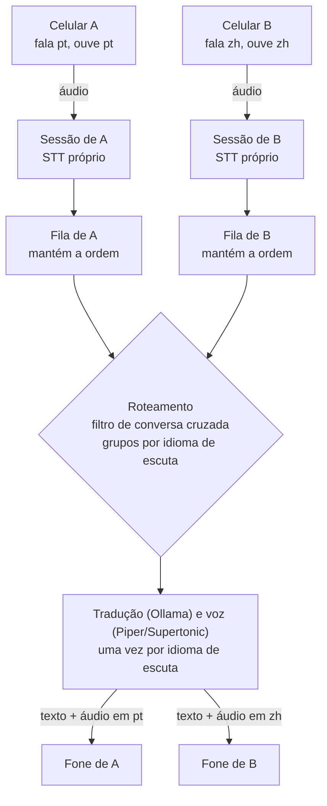
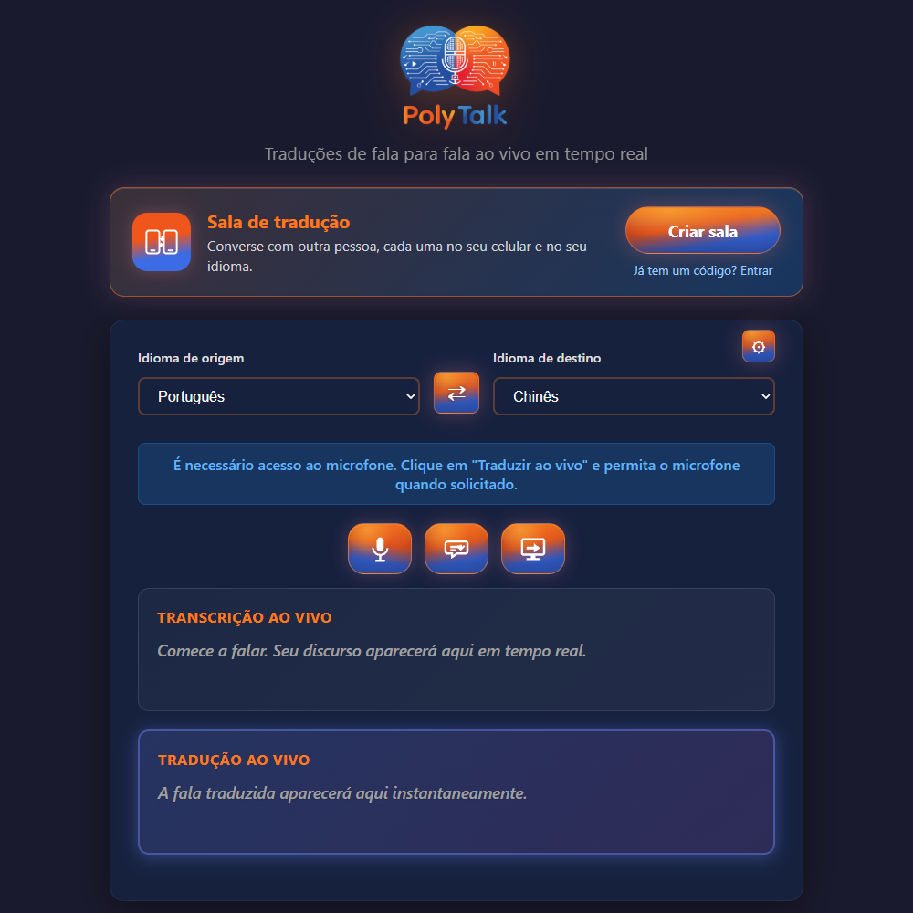
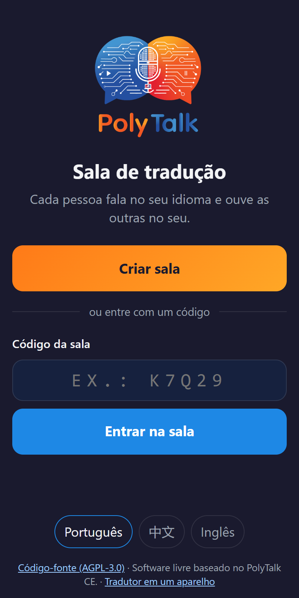
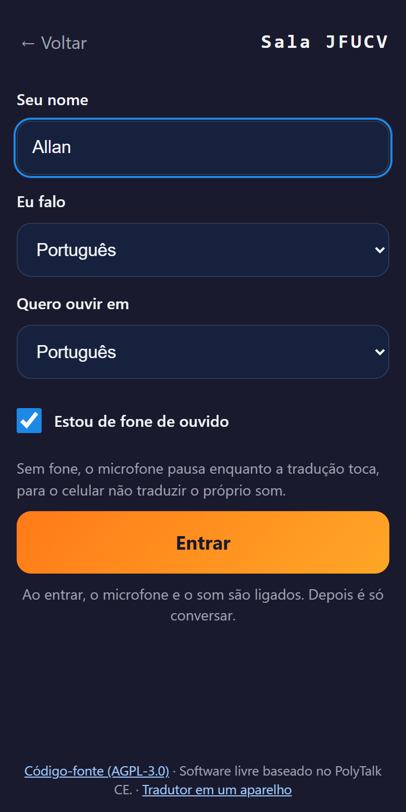
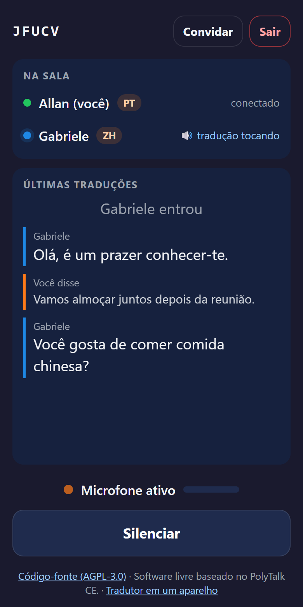
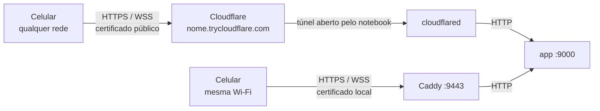

# Atividade 04 – Relatório de Implementação

**Disciplina:** Agentes de Codificação · **Professor:** Andrei Formiga  
**Integrantes:** Allan Gabriel e Gabriele Targino  
**Projeto da Atividade 03:** Sistema de Interpretação Simultânea Multiusuário em Rede Local  

---

## 1. Objetivo

Permitir que duas (e futuramente N) pessoas que falam idiomas diferentes conversem
frente a frente, cada uma usando o próprio celular e fone de ouvido. Cada
participante entra em uma sala virtual pelo navegador, escolhe seu idioma, fala
normalmente e ouve no próprio fone a tradução da fala do outro. A versão cobre
português, chinês (mandarim) e inglês, em rede Wi-Fi local, sem depender de
internet. As medições e a validação foram feitas no par português ↔ chinês.

## 2. Troca do projeto open source base

### 2.1 Projeto escolhido na Atividade 03

Na proposta (Atividade 03), o projeto base era o
**[open-realtime-translate](https://github.com/JacobLinCool/open-realtime-translate)**:
um servidor Python que implementa o protocolo da API Realtime de tradução da
OpenAI, com reconhecimento de fala (Qwen3-ASR), tradução (TranslateGemma 4B) e
síntese de voz (Qwen3-TTS ou Kokoro) rodando localmente. Faz interpretação
fala → fala em tempo real (WebSocket e WebRTC), com clonagem de voz e perfis MLX
(Apple Silicon), CUDA e CPU. Porém atende uma sessão por conexão, com um único
idioma de destino: sem salas, sem múltiplos usuários e sem interface web própria.
Tem 53 arquivos versionados e 4.599 linhas de Python sem testes.

### 2.2 Por que trocar

A análise do código e do hardware mostrou que o projeto original era complexo
demais para o escopo e para o equipamento da equipe:

1. **Hardware.** A máquina tem uma GPU RTX 4050 com 6 GB de VRAM e 15 GB de RAM,
   em Windows. O perfil de referência do projeto é Apple Silicon (MLX, ~7,1 GB
   residentes); no perfil CUDA, só o TranslateGemma 4B em bf16 ocupa ~8 GB, e a
   pilha completa ultrapassa 15 GB, sem quantização no backend de tradução.
2. **Modelos fixos.** ASR, tradução e TTS são embutidos no código: não há como
   delegar uma etapa a um serviço externo ou a um modelo menor sem modificar
   backends.
3. **Concorrência.** Toda a inferência passa por uma única thread serializada
   (exigência do MLX); com dois participantes falando, uma direção espera a outra,
   o que ameaça a meta de latência de 3 s.
4. **Esforço fora do foco.** O trabalho seria adaptar modelos ao hardware, e não
   construir a funcionalidade proposta (salas multiusuário).

### 2.3 Alternativas avaliadas

| Projeto                                                                           | Arquitetura                                                                                      | Offline                     | Prós                                                                                                  | Contras                                                                         |
| --------------------------------------------------------------------------------- | ------------------------------------------------------------------------------------------------ | --------------------------- | ------------------------------------------------------------------------------------------------------ | ------------------------------------------------------------------------------- |
| [open-realtime-translate](https://github.com/JacobLinCool/open-realtime-translate) | Servidor Python, 3 modelos locais fixos                                                          | Sim                         | Latência baixa de fábrica (~2,8 s/trecho em M5 Pro); WebRTC                                          | Não cabe no hardware; fila única de inferência                               |
| **[PolyTalk CE](https://github.com/PolyTalkIO/polytalk)** (escolhido)        | FastAPI + serviços Docker (faster-whisper, Piper/Supertonic) + tradução por API configurável | Sim, com LLM local (Ollama) | Leve (STT/TTS em CPU); tradução plugável; modo conversa bidirecional; mock mode; mantido ativamente | Código maior; latência padrão do STT alta; AGPL-3.0                          |
| [live-translate](https://github.com/sglkc/live-translate)                          | SPA Vue; reconhecimento e voz no navegador (Web Speech API)                                      | Não                        | Muito simples (~1.800 linhas); quase sem servidor                                                      | Depende de internet e do Google; contraria o requisito "rede local" da proposta |

### 2.4 Projeto escolhido: PolyTalk Community Edition

**[PolyTalk CE](https://github.com/PolyTalkIO/polytalk)** (commit `2aeadfd`, versão
0.4.0, 06/07/2026, licença AGPL-3.0, mantido pela BizzAppDev Systems).

**Funcionalidades existentes (antes da contribuição):**

- Captura de áudio no navegador (microfone ou aba compartilhada) por WebSocket e
  reconhecimento de fala por serviço faster-whisper próprio (CPU ou GPU).
- Tradução por qualquer provedor compatível (OpenAI, Ollama, vLLM, LM Studio,
  LiteLLM, Anthropic e Gemini), com roteamento por idioma, contexto entre trechos
  e instrução personalizada.
- Síntese de voz por Piper e Supertonic, com voz por idioma (inclui chinês e
  português).
- Modos `live` (tradução contínua em um sentido) e `conversation` (conversa
  bidirecional em **um único dispositivo**, detectando o idioma de cada fala).
- Interface web em JavaScript puro, em 14 idiomas; modo mock, Docker Compose,
  benchmarks, CI e guia de contribuição.
- **Não possui:** salas, múltiplos participantes em dispositivos diferentes, nem
  envio da tradução apenas ao ouvinte de destino.

**Tamanho (antes):** 118 arquivos, ~3,6 MB, 6.795 linhas de Python sem testes,
2.269 de JavaScript e 1.568 de CSS (comparação com o depois na seção 6).

### 2.5 Vantagens e desvantagens da troca

**Vantagens**

- **Roda no hardware disponível.** STT e TTS rodam em CPU, e a tradução usa um
  modelo pequeno via Ollama (2–3 GB de VRAM), com 0,15–0,4 s por frase (seção 3).
- **Mantém o requisito offline / rede local**, ao contrário da alternativa
  baseada no navegador, e a tradução é plugável: LLM local ou API externa, só por
  configuração.
- **Mais próximo do objetivo.** O modo `conversation` já resolve a detecção de
  idioma e a direção da tradução; a contribuição é estendê-lo a vários
  dispositivos (salas). STT, tradução e TTS são serviços separados, então a fala
  de um participante pode ser transcrita enquanto a de outro é traduzida.
- **Projeto mais maduro:** testes extensos, mock mode, CI e documentação de deploy.

**Desvantagens**

- **Base maior** (~6,8 mil linhas de Python de aplicação contra ~4,6 mil), com
  Docker Compose de 4 serviços.
- **Latência padrão inadequada para conversa** (janelas de 3 s e 1,2 s de
  silêncio) e sem números publicados: a viabilidade precisou ser medida por nós.
- **Tradução por LLM genérica**, que pode misturar idiomas ou alterar o sentido
  (seção 3). Sem clonagem de voz, e vozes mais simples que as do Qwen3-TTS.
- **Licença AGPL-3.0.** O código modificado deve ser oferecido a quem usar o
  serviço em rede; o fork público já atende.
- **Ajuste da proposta.** A Atividade 03 citava o open-realtime-translate; este
  relatório documenta a mudança.

## 3. Teste de viabilidade da tradução local

Antes de alterar o projeto, medimos a etapa de tradução isoladamente, chamando o
Ollama da mesma forma que o PolyTalk: endpoint compatível com OpenAI
(`/v1/chat/completions`), prompt de sistema do próprio PolyTalk e temperatura 0.
Foram usadas 6 frases de conversa em cada direção.

| Modelo                | VRAM   | PT→ZH (mediana) | ZH→PT (mediana) | Observações de qualidade                                                                   |
| --------------------- | ------ | ---------------- | ---------------- | -------------------------------------------------------------------------------------------- |
| `translategemma:4b` | 2,9 GB | 0,28 s           | 0,35 s           | ZH→PT natural e correto; 1 erro de sentido em PT→ZH ("falar mais devagar" virou "repetir") |
| `qwen2.5:3b`        | 2,2 GB | 0,16 s           | 0,25 s           | PT→ZH correto; em ZH→PT misturou inglês ("please") e alterou o sentido de uma pergunta    |

Conclusão: a tradução local consome menos de 0,5 s do orçamento de 3 s. **O modelo
adotado é o `translategemma:4b`**, que apresentou melhor qualidade, principalmente
em ZH→PT. A amostra é pequena.

## 4. Implementação

A implementação seguiu 8 etapas, cada uma numa branch própria, com um commit por
subtarefa, pull request no fork e tag `etapa-N-concluida` depois do merge. O
trabalho novo ficou em pacotes e arquivos novos (`app/rooms/`, página `/sala`,
proxy HTTPS, túnel, `bench/`). O código original recebeu 22 linhas de Python em
5 arquivos, nenhuma removida, e a tela inicial ganhou um cartão para a sala
(seção 6).

### 4.1 Arquitetura da solução

As salas são um módulo novo (`app/rooms/`), ao lado do código original. Cada
celular abre uma conexão WebSocket com a sala (`/api/ws/rooms/{código}`) e informa
o nome, o idioma de fala e o idioma de escuta. A conexão envia o áudio do microfone
no mesmo formato do PolyTalk.

- **Uma sessão por participante:** cada conexão tem o próprio fluxo de STT e uma
  fila de falas com um único worker, o que mantém a ordem das falas de cada pessoa.
- **Roteamento:** os ouvintes são agrupados pelo idioma de escuta. Cada grupo
  recebe uma tradução e uma voz. Quem falou não recebe nada, nem quem já ouve o
  idioma de quem falou.
- **Filtro de conversa cruzada:** se o STT de A detecta o idioma de fala de B, o
  trecho é a voz de B captada pelo microfone de A, e é descartado.
- **Ciclo de vida:** a sala vazia expira após 2 min e leva junto os áudios gerados.
  Áudios com mais de 10 min também são apagados com a sala ativa.
- **Marcas de tempo:** uma linha JSON por fala, com o fim da fala estimado no
  servidor e o momento de cada etapa, para a medição da Etapa 5.

Protocolo completo nas [notas da Etapa 2](notas-implementacao.md#21-projeto-das-salas).

#### Telas do sistema

Capturas da versão entregue, rodando na pilha real (Docker, Ollama e vozes locais).

  

**Tela inicial:** a tela original do PolyTalk, agora com o cartão "Sala de
tradução" (Criar sala / Já tem um código? Entrar) acima do tradutor de um aparelho.

<table>
  <tr>
    <td align="center"></td>
    <td align="center"></td>
    <td align="center"></td>
  </tr>
  <tr>
    <td align="center"><b>Página da sala</b></td>
    <td align="center"><b>Criar sala</b></td>
    <td align="center"><b>Conversa na sala</b></td>
  </tr>
</table>

- **Página da sala (`/sala`):** criar uma sala ou entrar com o código; a
  interface está em português, chinês e inglês.
- **Criar sala:** a sala recebe um código (aqui, `JFUCV`); cada pessoa informa o
  nome, o idioma em que fala, o idioma em que quer ouvir e se está de fone.
- **Conversa na sala:** vista pelo celular de Allan (fala e ouve português). A
  lista mostra quem está na sala e o idioma de cada um; abaixo, as traduções da
  fala de Gabriele (chinês) e, em "Você disse", a própria fala. A tradução tocou
  no fone e o texto ficou na tela como legenda.

As capturas foram feitas com dois navegadores no notebook e frases gravadas de
`bench/audio` no lugar do microfone, não com celulares reais. O texto em
português vem da tradução real do chinês, inclusive o "conhecer-te", de português
de Portugal (limitação descrita na seção 7).

### 4.2 Etapas

Plano completo, com subtarefas, árvore de prioridade e riscos, em
[planejamento.md](planejamento.md).

| Etapa        | Descrição                                                                                              | Status                                                                                                                                                                                                             |
| ------------ | -------------------------------------------------------------------------------------------------------- | ------------------------------------------------------------------------------------------------------------------------------------------------------------------------------------------------------------------ |
| 0            | Preparação do ambiente (fork, Docker, Ollama, modo mock)                                               | Concluída                                                                                                                                                                                                         |
| 1            | Linha de base e viabilidade da latência (portão de 3 s)                                                | Concluída: portão aprovado (PT→ZH 1,85 s, ZH→PT 2,45 s)                                                                                                                                                        |
| 2            | Salas e participantes no servidor, roteamento por ouvinte                                                | Concluída: sala real com 40/40 frases entregues só a quem devia                                                                                                                                                  |
| 3            | Interface web para celular                                                                               | Implementada: página `/sala`, interface em chinês e QR code; página e microfone conferidos num celular |
| 4            | Rede local e HTTPS                                                                                       | Implementada: proxy Caddy com autoridade local; sala real por `wss://` pelo IP da Wi-Fi sem perda de latência |
| 5            | Medição de latência por direção                                                                     | Concluída: sala real, PT→ZH 1,89 s e ZH→PT 2,79 s de mediana até o áudio começar (seção 4.6) |
| 6            | Testes automatizados e validação com dois celulares                                                    | Implementada: ensaio de 5 min na pilha real aprovado, roteiro de validação e avaliação preliminar |
| 7            | Documentação e entrega                                                                                 | Concluída: README (o que foi adicionado, build, testes), relatório e recontagem |
| Pós-entrega | Tela inicial com destaque para a sala; acesso pelo túnel da Cloudflare; roteiro em formato de checklist | Concluída (PR #9); túnel conferido num celular                                                                                                                                                                   |

### 4.3 Principais alterações no código

| Etapa | Alteração | Arquivos principais |
| ----- | --------- | ------------------- |
| 0 | `keep_alive` da tradução (`TRANSLATION_KEEP_ALIVE`, 4 testes); exemplo de configuração com Ollama local (`translategemma:4b`); `.gitattributes` com LF (correção para Windows) | `translation_service.py`, `.env.example`, `config/config.yaml.example`, `.gitattributes` |
| 1 | Correção no STT: pausas dentro da frase somavam como silêncio final e cortavam o fim da fala (com teste). STT na GPU (`small` fp16), espera de silêncio de 0,8 s, Supertonic com 4 passos. Frases e scripts de medição | `stt/app/main.py`, `docker-compose.gpu.yml`, `bench/` |
| 2 | Módulo de salas: criação e entrada por código, idioma de fala e de escuta por participante, um STT por participante, roteamento por idioma de escuta, filtro de conversa cruzada, limpeza dos áudios e marcas de tempo (30 testes). Rotas ligadas ao app e `APP_WORKERS=1`. Teste da sala real | `app/rooms/` (novo), `app/main.py`, `tests/test_rooms.py`, `bench/testar_sala.py` |
| 3 | Página `/sala` para celular: criar ou entrar por código, idiomas, participantes, legendas, silenciar, som liberado no toque, tela ligada, reconexão, QR code e aviso AGPL (22 testes). Interface em chinês (também na tela original). `rejoin` e link de entrada no servidor | `room.html`, `room-app.js`, `room.css`, `zh.json`, `app/rooms/router.py` |
| 4 | HTTPS na rede local: proxy Caddy com autoridade local, página do certificado, script que descobre o IP e libera o firewall, guia no README (8 testes). Nenhuma linha do app original mudou | `docker-compose.https.yml`, `caddy/`, `tools/rede-local.ps1` |
| 5 | Medição de latência: o celular mede o RTT e avisa quando o áudio começa (`playback_started`); o servidor calcula T6 no próprio relógio; tabela por direção (12 testes) | `app/rooms/latency.py`, `bench/latencia_sala.py` |
| 6 | Entradas, saídas, reconexões e toques no log; resumo da sessão de validação (3 testes); roteiro único de validação | `router.py`, `latencia_sala.py`, `docs/roteiro-validacao.md` |
| Pós | Tela inicial com cartão "Sala de tradução" e CSS/JS com `?v=<versão>` (feito pelo grupo). Túnel da Cloudflare (script) e link do QR que segue o endereço de acesso (1 teste) | `index.html`, `static_url.py`, `tunel-cloudflare.ps1`, `app/rooms/web.py` |

### 4.4 Redução da latência (Etapa 1)

A meta da Atividade 03 é que a mediana entre o fim da fala e o início do áudio
traduzido fique em até 3 s em cada direção. Na configuração original do PolyTalk, a
primeira medição deu 3,46 s (PT→ZH) e 4,38 s (ZH→PT). Depois dos ajustes da Etapa
1, ficou em **1,85 s e 2,45 s**: uma redução de 47% e 44%, sem perda de precisão
medida.

#### Como foi medido

Um conjunto fixo de 20 frases (10 PT, 10 ZH), em `bench/`, sintetizadas com as
vozes da própria pilha e enviadas pelo WebSocket como o navegador faz (blocos de
128 ms em tempo real, alternando PT e ZH). O relógio parte do último bloco com
fala, e cada mensagem do servidor marca uma etapa (transcrição, tradução, voz e
download do áudio). Foram 2 rodadas por configuração (20 medidas por direção),
tudo no próprio notebook, sem Wi-Fi; resultados em `bench/resultados/`.

Na configuração original, quase 80% do tempo estava antes da tradução: 1,2 s de
espera de silêncio e ~1,5 s de reconhecimento na CPU. A tradução, que se temia ser
o gargalo, levava 0,5 s. ZH→PT é sempre mais lenta porque a voz em PT (Supertonic,
1,06 s) é ~10× mais lenta que a em ZH (Piper, 0,12 s).

#### Mudanças e efeito de cada uma

| Passo | Mudança | PT→ZH (s) | ZH→PT (s) | Medição |
| ----- | ------- | --------- | --------- | ------- |
| 0 | Configuração original | 3,46 | 4,38 | `1.2-padrao`, 2 rodadas |
| — | Whisper `medium` na GPU (**descartado**) | 3,44 | 4,67 | `1.3-medium-gpu`, 2 rodadas |
| 1 | Whisper `small` na GPU (fp16) | 2,20 | 3,49 | `1.3-small-gpu`, 1 rodada |
| 2 | Correção do contador de silêncio do STT (não visa latência) | 2,12 | 3,08 | `1.4-pausa-1.2`, 1 rodada |
| 3 | Espera de silêncio de 1,2 s para 0,8 s | 1,67 | 2,75 | `1.4-final`, 2 rodadas |
| 4 | Voz em PT com 4 passos em vez de 8 | **1,85** | **2,45** | `1.6-final`, 2 rodadas |

1. **Reconhecimento na GPU (−1,0 a −1,3 s).** O `small` passou de 1,6–1,8 s por
   frase na CPU para 0,43 s, com os mesmos acertos, e a tradução também ficou mais
   rápida (0,52 → 0,24 s), porque a GPU deixou de ficar ociosa entre as falas.
2. **Correção no STT.** Pausas dentro da frase eram somadas como silêncio final e
   cortavam o fim da fala (seção 5.4). Não mira a latência.
3. **Espera de silêncio menor (−0,4 s).** Hesitações de até ~0,7 s não dividem a
   frase; a partir de ~1,0 s ela vira duas falas traduzidas separadamente.
4. **Voz em PT mais rápida (−0,3 s em ZH→PT).** Metade do tempo do padrão (8
   passos) e, transcrita pelo Whisper, tão compreensível quanto; a naturalidade
   ainda precisa ser conferida por alguém ouvindo. O PT→ZH subiu de 1,67 para
   1,85 s nesse passo por aquecimento depois de reiniciar o app (variação entre
   execuções iguais: 0,1–0,2 s).

#### Onde está o tempo agora

| Parte (mediana, s) | PT→ZH antes | PT→ZH depois | ZH→PT antes | ZH→PT depois |
| ------------------ | ----------- | ------------ | ----------- | ------------ |
| Espera de silêncio + reconhecimento | 2,79 | 1,42 | 2,74 | 1,40 |
| Tradução | 0,52 | 0,24 | 0,52 | 0,29 |
| Voz | 0,12 | 0,14 | 1,06 | 0,75 |
| Download do áudio | 0,02 | 0,02 | 0,01 | 0,02 |
| **Total até o áudio (mediana)** | **3,46** | **1,85** | **4,38** | **2,45** |
| Total até o áudio (p95) | 3,84 | 2,96 | 5,06 | 2,94 |

O que sobrou é, sobretudo, a espera de silêncio (0,8 s). Com duas pessoas falando
ao mesmo tempo, a mediana fica em 2,01 s e 2,64 s, e o p95 de ZH→PT chega a
3,5 s: as duas vozes sintéticas disputam a CPU.

#### O que foi tentado e descartado

- **Whisper `medium` na GPU.** Acertou mais no teste isolado (9 de 10 frases em
  chinês contra 8 do `small`), mas na conversa completa deixou o tradutor 2× mais
  lento (0,5 → 0,95 s, confirmado no log do Ollama), provavelmente por falta de
  memória de vídeo na GPU de 6 GB, e dentro do app não acertou mais que o `small`.
- **Whisper `large-v3-turbo` (int8).** O mais rápido dos grandes (0,58 s), mas
  errou palavras comuns em chinês (洗手间 → 携手间).
- **Espera de 0,6 s ou 0,4 s** (ganho de mais 0,3–0,4 s, mas pouca margem para
  pausas naturais; fica como opção se a rede somar tempo) e **voz em PT com 2
  passos** (várias frases incompreensíveis).

**Ressalvas.** O áudio de teste é sintético e o silêncio entre as falas é digital
(zero); com ruído de fundo de −45 dBFS, o STT não detectou o fim de nenhuma frase
(seção 4.5). A rede até os celulares e o início da reprodução não entram nesta
conta; a medição na sala real está na seção 4.6.

### 4.5 Dificuldades encontradas

- **Quebras de linha no Windows (Etapa 0).** Com `core.autocrlf=true`, o
  `entrypoint.sh` do Supertonic foi gravado com CRLF e o container entrou em loop
  de reinício. Resolvido com um `.gitattributes`.
- **Testes originais no Windows (Etapa 0).** Linha de base: 454 de 458. Duas falhas
  vinham do ambiente (`.env` local e codificação cp1252, resolvidas com
  `PYTHONUTF8=1`) e 4 só acontecem no Windows (caminho `/tmp` e arquivo de log
  aberto). Os testes originais não foram alterados.
- **Recarga do modelo de tradução (Etapa 0).** O Ollama descarrega o modelo após
  5 min parado, e a primeira fala depois de uma pausa custava de 4 a 16 s
  (tratado com o `keep_alive`).
- **GPU de 6 GB compartilhada (Etapa 1).** Com o Whisper `medium`, o tradutor
  ficou 2× mais lento; a troca do STT para a GPU só compensou com o `small`.
- **Ruído de fundo (Etapa 1).** O STT detecta o fim da frase por energia (RMS);
  com ruído de −45 dBFS, nenhuma frase foi fechada. Fica para os testes com celular.
- **Vários processos do app (Etapa 2).** O PolyTalk sobe 3 workers do gunicorn, e
  como as salas ficam na memória, duas pessoas da mesma sala poderiam cair em
  processos diferentes. O padrão passou para 1 worker.
- **Conversa cruzada custa STT em dobro (Etapa 2).** A mesma frase é transcrita
  duas vezes, disputando o único modelo na GPU: ~0,2 s a mais.
- **Celular abre por IP, sem SNI (Etapa 4).** Navegadores não mandam o nome do
  servidor no TLS quando o endereço é um IP. Resolvido com um certificado padrão
  (`default_sni`) no IP da Wi-Fi.
- **Troca de Wi-Fi invalida o acesso (pós-entrega).** O certificado é emitido para
  o IP do notebook; numa rede nova, sem rodar o `rede-local.ps1` de novo, o Chrome
  mostrava "Sua conexão não é particular". Essa fricção (certificado em cada
  celular, script a cada rede, Wi-Fi que isola aparelhos) motivou o túnel (seção 4.7).
- **Erro 500 depois de atualizar o código (pós-entrega).** A pasta `app/` é montada
  no container: templates valem na hora, mas o Python só é relido ao reiniciar. O
  template novo chamava `static_url`, que o processo antigo não conhecia. Resolvido
  com `docker restart polytalk`.

### 4.6 Medição de latência na sala (Etapa 5)

A latência medida é **T6 − T0**, por ouvinte, e todas as marcas usam o relógio
do servidor:

- **T0, fim da fala:** fim do último bloco de áudio com voz que chegou de quem
  fala antes da pausa que fechou a frase. A voz é detectada com o mesmo limiar de
  energia do STT (RMS ≥ 0,003). O plano previa T0 = T1 − espera de silêncio, mas o
  detector de voz da sessão (Etapa 2) marca o fim real. No teste, o T0 do
  servidor ficou a 1 ms do fim real que o cliente conhecia (mediana).
- **T6, início do áudio traduzido:** evento `playing` do player no celular de
  quem ouve. O celular avisa o servidor (`playback_started`), e o servidor usa a
  hora de chegada menos metade do RTT, que o celular mede com o `ping` no próprio
  relógio. O relógio do celular nunca é comparado com o do notebook. O erro
  possível é a assimetria da rede, no máximo meio RTT.
- `bench/latencia_sala.py` lê o log e gera a tabela por direção, com mediana,
  p95, máximo e o tempo de cada etapa.

Sala real com dois clientes simulados no notebook, com conversa cruzada, 40 falas:

| Direção | Mediana T0→T6 | p95    | Máximo | Falas ≤ 3 s |
| --------- | -------------- | ------ | ------- | ------------ |
| PT→ZH    | 1,89 s         | 2,40 s | 2,41 s  | 20/20        |
| ZH→PT    | 2,79 s         | 3,35 s | 3,43 s  | 12/20        |

| Direção | Silêncio + STT | Tradução | Voz    | Rede e download |
| --------- | --------------- | ---------- | ------ | --------------- |
| PT→ZH    | 1,55 s          | 0,24 s     | 0,12 s | 0,01 s          |
| ZH→PT    | 1,69 s          | 0,28 s     | 0,74 s | 0,02 s          |

O ZH→PT fica perto do limite porque a voz em português (Supertonic) leva 0,6 s a
mais que a voz em chinês (Piper). "Silêncio + STT" inclui os 0,8 s de espera de
silêncio. Ficam fora a decodificação do áudio no navegador, a Wi-Fi real e o
atraso do fone Bluetooth (~0,1–0,3 s). Detalhes em [etapa-5-latencia.md](etapas/etapa-5-latencia.md#resultado).

### 4.7 Acesso pelo túnel da Cloudflare (pós-entrega)

O caminho da Etapa 4 exige instalar um certificado em cada celular, rodar o
script a cada rede e uma Wi-Fi em que os aparelhos se enxerguem. Para destravar o
primeiro teste com celular, foi adicionada uma alternativa: um *Quick Tunnel* da
Cloudflare (`cloudflared`, sem conta), que publica o app num endereço com
certificado público.

- **Uso:** `tools\tunel-cloudflare.ps1` confere se o app responde, abre o túnel
  e mostra `https://<nome>.trycloudflare.com/sala`. O celular abre sem aviso e
  libera o microfone, em qualquer rede.
- **QR code:** o link de convite passou a usar o endereço pelo qual quem criou a
  sala abriu a página. Antes, `ROOM_PUBLIC_BASE_URL` (o IP da Wi-Fi) sempre
  vencia, e o QR de uma sala criada pelo túnel mandaria o segundo celular para o
  IP local. Agora ele só substitui `localhost`, que o celular não alcança.
- **Custos:** o áudio passa pela internet (notebook → Cloudflare → celular), o
  que soma latência; o endereço muda a cada execução e fica público enquanto o
  túnel está aberto; e o sistema passa a depender de internet, ao contrário da
  proposta. Por isso a medição de latência planejada usa a Wi-Fi com o Caddy;
  as medições da seção 4.6 vêm de clientes simulados no próprio notebook.
- **Primeiro teste num celular (24/11/2026):** pelo túnel, a página abriu sem
  aviso, o microfone foi liberado e a sala funcionou (itens B6 e B7 do
  [roteiro](roteiro-validacao.md)). Impressão de quem testou: latência alta em
  algumas frases e transcrição apenas razoável, aceitável para um protótipo.
  Sem medição de latência com celulares.

## 5. Processo de desenvolvimento com agentes

Seção central do relatório, segundo o enunciado.

### 5.1 Como os agentes foram usados em cada etapa

| Etapa | Uso do agente | Intervenção humana |
| ----- | ------------- | ------------------ |
| Escolha do projeto | Leu o código de três candidatos, levantou o hardware, comparou requisitos e recomendou a troca | O grupo decidiu trocar, por considerar o projeto original complexo demais |
| Viabilidade da tradução | Instalou o Ollama, rodou o teste PT↔ZH com o prompt do PolyTalk e avaliou as traduções | O grupo escolheu o modelo (`translategemma:4b`) |
| Planejamento | Leu partes do PolyTalk e montou o plano em 8 etapas, com prioridades, riscos e branches | O grupo pediu a divisão em arquivos por etapa e uma branch por etapa |
| 0 – Preparação | Executou as 8 subtarefas: importou o histórico, configurou o Ollama, construiu as imagens, rodou os testes originais, diagnosticou o CRLF, implementou o `keep_alive` com testes e fez um teste de ponta a ponta com fala sintética | Conferência visual e teste falado PT↔ZH por um integrante (o agente não tinha navegador nem microfone) |
| 1 – Viabilidade | Criou o conjunto de frases e 6 scripts de medição, mediu tudo, diagnosticou a lentidão do `medium` pelo log do Ollama, corrigiu um bug do STT com teste e escolheu a configuração que passou no portão | Revisão da correção do STT e da voz em PT com 4 passos |
| 2 – Salas | Projetou e escreveu `app/rooms/` (30 testes), notou que os 3 workers quebrariam as salas, testou a sala real (com e sem conversa cruzada) e conferiu a limpeza dos áudios | Revisão do PR e do protocolo usado pela Etapa 3 |
| 3 – Interface | Leu o `AudioRecorder` e o i18n do PolyTalk e escreveu telas, JS, CSS, catálogo em chinês, QR code e reconexão (22 testes). Previu o microfone mudo no Safari, o eco sem fone e o participante fantasma após uma queda | Conferência no celular (som, tela, Wi-Fi, QR) e revisão dos textos em chinês |
| 4 – Rede e HTTPS | Comparou as opções e escreveu proxy, página do certificado, script do `.env` e do firewall, guia e 8 testes; verificou pelo IP da Wi-Fi, inclusive uma sala por `wss://`. Notou a falta de SNI com IP, o QR com `http` e que `ALLOWED_ORIGINS` não bloquearia o celular | Instalação do certificado e conferência do microfone nos celulares; firewall liberado como administrador |
| 5 – Latência | Notou que parte já existia (marcas da Etapa 2 e aviso do celular), propôs medir no relógio do servidor com o RTT do `ping`, escreveu análise, script e 12 testes e conferiu o T0 contra o fim real da fala | Medição com celulares (sessão da Etapa 6) |
| 6 – Testes | Rodou a suíte, escreveu o roteiro, fez o log contar toques e reconexões, ensaiou 5 min na pilha real e deu nota preliminar às 20 traduções; testou uma instrução pt-BR no prompt e a descartou | Sessão com celulares e nota humana da tradução |
| 7 – Entrega | Escreveu a parte do README exigida, recontou arquivos e linhas (conferido contra o `2aeadfd`) e preencheu o relatório a partir das notas | Revisão do relatório e vídeo curto da conversa |
| Pós-entrega | Diagnosticou o aviso de certificado após a troca de Wi-Fi, propôs e escreveu o túnel (com teste), achou a causa do erro 500 e passou o roteiro para checklist | O grupo fez a tela inicial nova e o primeiro teste num celular, pelo túnel |

### 5.2 O que funcionou

- **Teste sintético de ponta a ponta (Etapa 0).** Sem microfone, o agente gerou
  fala com as próprias vozes da pilha (Supertonic para PT, Piper para ZH) e a enviou
  pelo WebSocket no mesmo formato do navegador. Isso validou as duas direções antes
  do teste humano e já revelou dois problemas para a Etapa 1: transcrição do
  chinês em caracteres tradicionais, com erros, e latência de 3,6 a 5,3 s.
- **Medição de ponta a ponta como critério (Etapa 1).** Em cada mudança de
  configuração, o agente mediu a conversa inteira, além da peça isolada. Foi isso
  que mostrou que o `medium` piorava o sistema e que revelou o bug do silêncio: a
  latência *caía* quando se inseria uma pausa na frase, o que não fazia sentido.
- **Conversa cruzada simulada (Etapa 2).** Sem dois celulares, o agente simulou
  duas pessoas frente a frente: o microfone de quem ouve recebe a fala do outro,
  atenuada. Isso testou o filtro com o STT real antes de existir a interface.
- **Ler o código antes de seguir o plano (Etapas 3 e 4).** O agente leu o módulo
  de captura do PolyTalk e viu que ele criaria o contexto de áudio na hora errada
  para o Safari. Leu o CORS e viu que a lista de origens não bloquearia o
  celular, ao contrário do que o plano supunha. Nos dois casos, o trabalho foi
  para o problema real.
- **Prever falhas que só apareceriam no celular (Etapa 3).** Eco sem fone,
  participante fantasma depois de uma queda de Wi-Fi, tela apagando no meio da
  conversa: tudo tratado antes de existir um celular para testar.
- **Simular o celular inteiro (Etapas 4 a 6).** O mesmo script da Etapa 2 passou
  a validar o certificado como o celular (Etapa 4), a medir o RTT e avisar o
  início da reprodução (Etapa 5) e a rodar uma conversa de quase 7 min (Etapa
  6). Cada etapa reaproveitou a ferramenta da anterior.
- **Conferir a medida por outro caminho (Etapa 5).** O T0 do servidor foi
  comparado com o fim real da fala que o cliente simulado conhecia (1 ms de
  diferença), e o T6 do servidor com o tempo medido pelo cliente. Sem essa
  conferência, a tabela de latência seria só uma afirmação.
- **Uma alternativa em vez de insistir (pós-entrega).** Quando o certificado
  local virou obstáculo para o primeiro teste, o agente propôs o túnel, que
  destravou o teste com celular no mesmo dia, e ajustou o link do QR para não
  quebrar o caminho pela Wi-Fi.
- **Transformar critérios humanos em números (Etapa 6).** "Sem acionar botões" e
  "cada um ouve só o seu" viraram contagens no log (toques, reconexões, tradução
  entregue a quem falou), além da anotação dos participantes.

### 5.3 O que não funcionou

- **Checagem de CRLF enganosa (Etapa 0).** O agente verificou as quebras de linha
  com `grep` e concluiu, errado, que estavam corretas; o erro só apareceu quando o
  container quebrou. A forma confiável é `git ls-files --eol`.
- **Leitura apressada de uma nota (Etapa 0).** O agente repetiu que "a interface não
  tem chinês" e sugeriu que o teste falado dependeria da Etapa 3. Na verdade, só os
  textos da interface não têm chinês; os seletores de tradução têm. O erro foi
  percebido ao preparar as instruções do teste visual e corrigido nas notas.
- **Sem acesso ao navegador (Etapa 0).** A extensão do Chrome não estava conectada,
  então a interface só pôde ser conferida por um integrante.
- **Escolha com base em medições isoladas (Etapa 1).** O agente escolheu o Whisper
  `medium` na GPU porque ele acertou mais no teste do STT e era mais rápido que o
  `small` em CPU. Já com ele aplicado, a medição de ponta a ponta mostrou que ele
  deixava o tradutor 2× mais lento, e dentro do app ele não acertava mais que o
  `small`. A escolha foi revista.
- **Erros nos próprios scripts (Etapa 1).** Um tempo de download medido no lugar
  errado (1,5 s em vez de 0,02 s) e um caractere nulo inserido por escape errado
  no shell. Os dois foram percebidos porque o resultado não fazia sentido.
- **Sem celular nem navegador até o fim.** Nenhuma tela foi vista pelo agente, e
  a extensão do Chrome nunca se conectou. Tudo o que depende de microfone,
  alto-falante, Wi-Fi e navegador móvel ficou para conferência humana nos
  celulares ([roteiro](roteiro-validacao.md)). A validação com dois aparelhos é a
  maior lacuna.
- **O agente atrapalhou a própria medição (Etapa 6).** Rodou um teste no Ollama
  durante o ensaio de 5 min (ver 5.4).

### 5.4 Imprevistos

- **O projeto planejado não cabia no hardware.** Só a análise do código mostrou que a
  configuração padrão do open-realtime-translate precisava de mais memória de vídeo
  do que a GPU disponível (6 GB). Isso levou à troca de projeto (seção 2).
- **Medição enganosa por causa de `localhost`.** O primeiro teste de tradução indicou
  ~2,3 s por frase, quase igual para frases curtas e longas. O padrão levantou a
  suspeita: no Windows, `localhost` tenta IPv6 antes de IPv4 e perde ~2 s. Com
  `127.0.0.1`, o tempo real era 0,15–0,4 s. Sem essa verificação, a tradução teria
  parecido inviável.
- **O PolyTalk já tinha um modo de conversa bidirecional** em um único dispositivo,
  que não aparecia em destaque na documentação. Ele virou a base das salas.
- **O bloqueio de permissões levou a uma solução melhor (Etapa 0).** A primeira
  ideia do agente para manter o modelo carregado era mudar uma variável de ambiente
  do Windows e reiniciar o Ollama, e o controle de permissões bloqueou. Ao procurar
  outro caminho, o agente descobriu que o endpoint OpenAI do Ollama aceita
  `keep_alive` por requisição. A solução foi para o código, versionada e testada, e
  não depende da configuração da máquina.
- **Bug no PolyTalk revelado pela medição (Etapa 1).** O contador de silêncio do
  STT não zerava quando a fala voltava. Uma hesitação no meio da frase fazia o
  STT fechar cedo e cortar o fim ("o prazo está muito curto" → "o prazo está
  morto"). Corrigido em uma linha, com teste.
- **Uma nota anterior estava errada (Etapa 2).** A nota da 1.3 dizia que a
  detecção de idioma era "restrita a pt/zh". Ao projetar o filtro, a leitura do STT
  mostrou que a lista de idiomas candidatos é recebida e confirmada, mas não é
  usada: o Whisper detecta entre todos os idiomas. As medições continuam válidas;
  a explicação foi corrigida.
- **Ordem das etapas trocada (Etapa 3).** A interface foi feita antes do HTTPS.
  No notebook, `127.0.0.1` já libera o microfone; nos celulares, não. A
  conferência nos aparelhos ficou para depois da Etapa 4.
- **O plano supunha um bloqueio que não existia (Etapa 4).** A subtarefa 4.4 previa
  que a lista de origens do PolyTalk barraria o celular. Ao ler o código, o agente
  viu que ela só vale para CORS e que a sala é da mesma origem. O problema real,
  não previsto, era o link do QR code sair com `http` atrás do proxy.
- **Um erro de tradução escondido por um erro do STT (Etapa 6).** Na sala, o
  STT ouviu 星期散 em vez de 星期三 (quarta-feira), e a tradução simplesmente
  omitiu o dia. Traduzindo o texto correto, o modelo respondeu "terça-feira".
  Avaliar só o fluxo completo teria escondido esse erro.
- **Medição contaminada pelo próprio agente (Etapa 6).** Um teste rápido de
  prompt rodou contra o Ollama enquanto o ensaio de 5 min usava a mesma GPU, e uma
  frase subiu para 3,6 s. O agente percebeu, interrompeu e repetiu o ensaio sem
  outra carga.
- **O primeiro obstáculo com celular foi a rede, não o código (pós-entrega).**
  Bastou trocar de Wi-Fi para o certificado do IP antigo deixar de valer. O
  túnel, que não estava no plano, virou o caminho do primeiro teste.

### 5.5 Trabalhar num projeto já existente

- **Entender antes de mudar.** O PolyTalk tem ~6.800 linhas de Python e ~2.300
  de JavaScript. O agente começou cada etapa lendo a parte do código que ela
  tocava (modo conversa, STT, captura de áudio, i18n, CORS, configuração do
  gunicorn) e registrando o que encontrou nas notas. Foi assim que apareceram o
  modo de conversa bidirecional que virou a base das salas, os 3 workers que
  quebrariam as salas em memória e a lista de idiomas que o STT recebia mas não
  usava.
- **Reaproveitar sem copiar.** As salas usam o pipeline original (STT, tradução e
  voz) pelas mesmas interfaces da tela original. O que não servia como estava
  (captura de áudio no Safari) virou uma subclasse, não uma cópia alterada.
- **Mudar o mínimo no original.** Tudo o que é novo está em arquivos novos. No
  código original: 22 linhas de Python em 5 arquivos (registrar as rotas das
  salas, `keep_alive` da tradução, idioma chinês na interface, a correção do
  STT e a versão nos endereços de CSS e JS), o cartão da sala na tela inicial
  e configuração.
- **Compatibilidade verificada a cada etapa.** A suíte original rodou em todas
  as etapas com o mesmo resultado da linha de base, e os testes originais só
  receberam acréscimos. A tela original continua funcionando, agora também em
  chinês.
- **Duas correções de bugs do original** (STT cortando o fim da frase e o
  `keep_alive`) foram feitas com teste, de forma que poderiam ser oferecidas aos
  mantenedores depois da disciplina.
- **Ambiente diferente do dos mantenedores.** O projeto foi escrito para Linux;
  no Windows apareceram CRLF em scripts, 4 testes que só falham no Windows e o
  `localhost` lento. Nenhum era bug do projeto, mas cada um custou tempo até ser
  entendido.

## 6. Resultado: antes e depois

| Métrica                   | PolyTalk original (`2aeadfd`) | Após a contribuição | Diferença                                                                                      |
| -------------------------- | ------------------------------- | ---------------------- | ----------------------------------------------------------------------------------------------- |
| Arquivos versionados       | 118                             | 225                    | +107 (inclui docs, resultados das medições e áudios de teste)                                |
| Python sem testes (linhas) | 6.795                           | 10.181                 | +3.386: salas 1.668, scripts de medição 1.674, versão dos estáticos 22, código original 22 |
| Testes Python (linhas)     | 10.153                          | 11.478                 | +1.325 (4 arquivos novos e acréscimos em 2 originais)                                          |
| JavaScript (linhas)        | 2.269                           | 3.185                  | +916 (`room-app.js`)                                                                          |
| CSS (linhas)               | 1.568                           | 1.895                  | +327 (`room.css` e o cartão da sala na tela inicial)                                         |
| HTML (linhas)              | 277                             | 502                    | +225 (`room.html`, página do certificado, cartão da sala na tela original)                  |

| Funcionalidade                                   | Antes                          | Depois                                                                                                                                                                            |
| ------------------------------------------------ | ------------------------------ | --------------------------------------------------------------------------------------------------------------------------------------------------------------------------------- |
| Tradução fala → fala em um dispositivo        | Sim                            | Sim (preservada)                                                                                                                                                                  |
| Conversa bidirecional em um dispositivo          | Sim                            | Sim (preservada)                                                                                                                                                                  |
| Salas com código de acesso                      | Não                           | Sim: servidor (Etapa 2) e página `/sala` com QR code (Etapa 3)                                                                                                                 |
| Interface em chinês                             | Não (13 idiomas, sem chinês) | Sim, na sala e na tela original                                                                                                                                                   |
| Vários participantes em dispositivos diferentes | Não                           | Sim, no servidor (até 8 por sala; validados 2)                                                                                                                                   |
| Idioma de fala e de escuta por participante      | Não                           | Sim                                                                                                                                                                               |
| Tradução entregue apenas ao ouvinte de destino | Não                           | Sim, com filtro de conversa cruzada                                                                                                                                               |
| Acesso por celular via HTTPS                     | Não                           | Sim: na rede local, proxy com certificado local e guia de instalação (Etapa 4); de qualquer rede, túnel da Cloudflare sem certificado (seção 4.7), já conferido num celular |
| Medição de latência por direção             | Não                           | Sim: marcas por etapa, T6 informado pelo celular e tabela por direção (`bench/latencia_sala.py`)                                                                              |

## 7. Limitações e trabalhos futuros

**Limitações da versão entregue**

- **Sem validação com dois celulares.** Latência, roteamento e a conversa de
  5 min foram verificados na pilha real com clientes simulados. Um celular abriu
  a sala e liberou o microfone pelo túnel, mas ruído, Wi-Fi e a conversa entre
  dois aparelhos não foram medidos. O [roteiro](roteiro-validacao.md) descreve
  essa sessão.
- **Ruído de fundo.** O fim da frase é detectado por energia. Com ruído a partir
  de −45 dBFS, o STT não fecha a frase (Etapa 1). Num ambiente barulhento, a
  conversa pode travar até alguém parar de falar por mais tempo.
- **ZH→PT perto do limite.** Mediana entre 2,5 e 2,8 s, com p95 acima de 3 s,
  por causa da voz em português (Supertonic). Fone Bluetooth soma ~0,2 s, que o
  sistema não mede.
- **Qualidade.** O tradutor às vezes usa português de Portugal e errou um dia da
  semana; o Whisper `small` erra caracteres chineses e escreve parte em
  tradicional. A avaliação das traduções foi feita pelo agente, não por falantes.
- **Um notebook, uma GPU de 6 GB.** STT, tradução e voz disputam a mesma GPU;
  com mais pessoas falando ao mesmo tempo a latência sobe. Validado com 2
  participantes.
- **Salas em memória.** Um único processo do app (`APP_WORKERS=1`); reiniciar o
  app encerra as salas.
- **Certificado instalado à mão** em cada celular, e o IP do notebook muda com a
  rede. O túnel evita as duas coisas, mas depende de internet, soma latência,
  muda de endereço a cada execução e fica público enquanto está aberto.

**Trabalhos futuros**

- Validar 3 ou mais participantes e outros pares de idiomas (o código já
  suporta até 8 por sala e qualquer idioma do PolyTalk).
- Detector de voz mais robusto a ruído (VAD por modelo) no lugar do limiar de
  energia.
- Modelo de tradução com controle da variante do português, e Whisper maior
  quando houver mais memória de vídeo.
- Voz em português mais rápida, para tirar o ZH→PT de perto do limite.
- Serviço de tradução dentro do Docker Compose, versão publicada e chave de API
  escolhida pelo usuário.
- Oferecer aos mantenedores, depois da disciplina, as correções do STT e do
  `keep_alive`, que independem das salas.

## 8. Aprendizados e conclusão

### 8.1 O que o grupo aprendeu

- **Sobre agentes de codificação**
  - O agente rende mais com um plano em etapas pequenas e verificáveis e com a
    regra de registrar tudo nas notas. As notas viraram a memória entre sessões
    e a fonte deste relatório.
  - Ele precisa de um jeito de verificar o próprio trabalho. Onde havia
    medição de ponta a ponta (latência, sala real simulada), os erros apareceram
    cedo. Onde não havia (telas no celular), tudo ficou para a conferência
    humana.
  - Os erros do agente foram, na maioria, de pressa e não de conhecimento:
    checagem de CRLF com a ferramenta errada, nota lida às pressas, medição no
    lugar errado, teste rodando junto com o ensaio. Resultados que "não faziam
    sentido" foram o melhor alarme.
- **Sobre manutenção de software existente**
  - Ler o código antes de seguir o plano mudou várias decisões: o plano supunha
    bloqueios que não existiam e não previa problemas que existiam.
  - Mudanças pequenas no original e trabalho novo em arquivos novos deixam a
    compatibilidade fácil de provar: a mesma suíte, com o mesmo resultado.
  - Medir antes de otimizar: a troca do STT só foi decidida depois de ver onde
    estava o tempo, e uma escolha baseada em medições isoladas teve de ser
    desfeita.
- **Sobre as tecnologias**
  - Em tempo real, o gargalo raramente é o modelo de tradução (0,3 s); é a espera
    de silêncio e a síntese de voz.
  - O navegador móvel impõe regras (HTTPS para o microfone, som só depois de um
    toque, tela que apaga) que moldam a arquitetura tanto quanto o servidor.
  - Uma GPU de 6 GB comporta STT, tradução e voz, mas cada modelo maior afeta os
    outros.

### 8.2 Conclusão

O fork do PolyTalk ganhou salas multiusuário em rede local: cada pessoa entra
pelo celular, escolhe o idioma, fala normalmente e ouve no próprio fone só a
tradução da fala dos outros, com tudo rodando num notebook. Na pilha real, com
dois participantes simulados e conversa cruzada, o sistema entregou 60 de 60
falas só a quem devia numa conversa de quase 7 min, sem nenhum toque, com
mediana de 1,8 s (PT→ZH) e 2,5 s (ZH→PT) do fim da fala ao início do áudio
traduzido, dentro da meta de 3 s. O código original mudou em 22 linhas de
Python e a suíte original continua com o mesmo resultado. Depois da entrega, o
túnel da Cloudflare permitiu o primeiro teste num celular real sem instalar
certificado.

A conversa entre dois celulares reais ainda não foi medida: os números vêm de
clientes simulados e de um teste com um celular pelo túnel.
